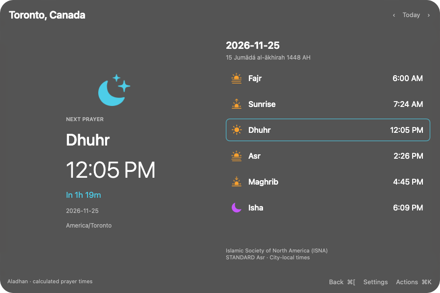

# Adhan Time for Alfred

City-local prayer times, next-prayer countdown and daily calendars in a native Alfred 6 window.
Inspired by [Raycast Adhan Time](https://github.com/raycast/extensions/tree/e38232e713cc42a58cac81b8d3af9261fd1624e5/extensions/adhan-time), with data from [Aladhan](https://aladhan.com/prayer-times-api).



Requires macOS, Alfred 6 Powerpack, Node.js 22+ or Bun, and internet for uncached calendars. No API key.

## Use

Type **`adhan`**. On first launch, Settings asks for your city and country. Choose the calculation method
and Asr school used by your mosque; the default method is ISNA and school is Standard. Select Hanafi
when appropriate. The clock supports 12-hour and 24-hour formats.

You can also type **`adhan Toronto, Canada`** to view another city without saving it. In-window Settings
persist in Alfred's workflow data and override Workflow Configuration defaults. Edit Settings again
to change them. The workflow does not request device location or infer your religious preferences.

The left pane shows the next prayer using the city's timezone and a countdown refreshed every 30 seconds
while open. The right pane shows the selected Gregorian/Hijri date and Fajr, Sunrise, Dhuhr, Asr, Maghrib
and Isha. Sunrise is informational; it is excluded from the next-prayer countdown. After Isha the next
prayer is tomorrow's Fajr, including the next month when available. Browsing another date keeps the
countdown anchored to the actual current day.

| Shortcut | Action |
| --- | --- |
| ← / → | Previous / next date |
| ⌘R | Refresh selected calendar |
| ⌘K | Open Actions |
| ⌘[ | Configurable Back; sheets return to their parent |

Today returns to the current date in the city's timezone. **Actions** contains Today, Previous Day,
Next Day, Copy Daily Prayer Times, Calculation Details, Settings, Refresh Calendar and Open Aladhan.
Back is always visible in the footer and stays outside Actions. Direct launch Back returns to Alfred
search. The `open` external trigger accepts `City, Country` for the future Swiss launcher.

## Data and calculation

Calendars cache for 24 hours by city/country, method, school and month. Refresh bypasses the cache;
failed refresh retains and explicitly marks the cached calendar. Missing times and unavailable future
calendars remain unknown rather than reusing yesterday's times. Dates and timezone come from Aladhan.
The method dropdown uses IDs verified against [Aladhan's methods endpoint](https://api.aladhan.com/v1/methods);
these correct mismatches in several labels in the pinned Raycast reference.

These are calculated times and may differ from your mosque's timetable. Confirm method and school
locally. Hijri dates follow the provider's calendar. The workflow does not play audio, schedule alarms
or run a background service when closed. City/country and your public IP are visible to Aladhan.
Settings and cache stay in Alfred's local workflow directories.

## Configuration

<!-- config:start (generated by scripts/readme-config.ts from info.plist; do not edit) -->
Open the workflow in Alfred Preferences → **Configure Workflow**.

| Setting | Default | What it does |
| --- | --- | --- |
| Calendar cache minutes | `1440` | 1–10080 minutes. Manual Refresh bypasses cached results; provider publication frequency is independent. |
| Adhan Time keyword | `adhan` | View prayer times; optionally append City, Country. |
| City | — | City whose prayer times you want; can also be set in the window. |
| Country | — | Country for city disambiguation. |
| Calculation method | Islamic Society of North America (ISNA) | Choose the method used by your mosque. Provider method IDs are verified against Aladhan. |
| Asr school | Standard (Shafi / Maliki / Hanbali) |  |
| 12-hour clock | On |  |
| Actions shortcut | `⌘K` | Open prayer time actions. |
| Back shortcut | Hyper+B (`⌃⌥⇧⌘B`) | Hyper modifier checkboxes plus a Back key; turn Hyper off to use a custom shortcut instead. |
| Open window | Inside Alfred | Choose Alfred’s window or a separate window. |
| Node.js executable | — | Optional absolute path if automatic discovery fails. |
<!-- config:end -->

## Development

```sh
bun install --frozen-lockfile
bun run check
bun run package
bun run link
```

Output: `dist/Adhan Time.alfredworkflow`. Releases use `z-adhan-time/vX.Y.Z`.
UI and metadata are generated from `ui/window.ts` and `scripts/plist.ts`.
See [TESTING.md](TESTING.md) for verification and interactive checks.

## Credits

Icon/reference: Raycast Adhan Time by mzaien, menisy, YourMCGeek and contributors, MIT.
Prayer calculations: Aladhan. See [THIRD_PARTY_NOTICES.md](THIRD_PARTY_NOTICES.md) and [LICENSE](LICENSE).

Built with help from AI tools. Review before use and report issues on the
[project tracker](https://github.com/sk-izsk/z-alfred-workflow/issues).

## Swiss launcher integration

When opened from Swiss, the root Back returns to the same launcher search/selection. Child screens
and sheets still go back one level first. Direct launches keep their normal Back behavior. Install
Swiss separately; it is optional and does not run this tool until selected.

## Data refresh controls

Calendar cache minutes is configurable (default 1440). Manual Refresh bypasses the cache; provider-calculated prayer times and original dates remain visible when cached.

## Ramadan timetable

Open Ramadan from the footer or Actions. Choose a Gregorian year to see the provider’s complete 29/30-day calendar, with Gregorian dates, Imsak, Fajr and Maghrib/Iftar in the configured city timezone. Copy Timetable exports the table. Imsak is shown separately as the provider’s precautionary time; confirm local practice with your mosque. Back closes the table to the prayer calendar.

The Ramadan picker uses Gregorian years (for example, 2027); the heading also shows the Hijri year. It asks Aladhan for the actual Gregorian-to-Hijri mapping and loads each complete Ramadan beginning in that year, including two Ramadans in a Gregorian year. Opening the timetable or changing years requests fresh data. **Refresh** bypasses the cache; Copy reuses the fetched table. The footer shows fetch time or a stale warning. These are calculated dates: local moon-sighting announcements can differ.

During Ramadan, the city-local current date is labeled **Today** and highlighted using Alfred’s theme colors. The table selects today when opened, and its marker advances at the city’s midnight while the window remains open.

Shared UI: windows use the 780-point reference width with active-display clamping. Back defaults to Hyper+B (Control + Option + Shift + Command + B); Configuration includes the Hyper toggle, four modifier checkboxes, Back key and custom shortcut. Footer labels use Hyper+B. Existing explicit custom Back shortcuts remain active until Hyper configuration is explicitly saved.
