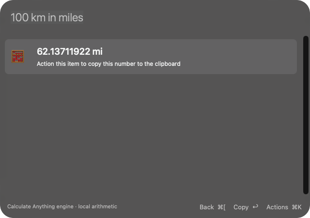

# Calculate Anything bridge for Alfred

A separate native results window for the Calculate Anything engine you already have installed.
It reuses [biati digital's Calculate Anything](https://github.com/biati-digital/alfred-calculate-anything)
instead of replacing its unit-conversion logic, original keywords or settings.



Requires Alfred 6 Powerpack, Node.js 22+ or Bun, and the original Calculate Anything workflow with its
complete dependencies and PHP runtime for natural-language conversion. Basic arithmetic works locally.

## Use

- `calcany 100 km in miles`
- `calcany 2 GB in MB`
- `calcany 100 + 16%`
- `calcany time now plus 6 hours`
- `calcany vat 100`
- `calcany 100+24/12`

The original engine handles units, percentages, data storage, time, VAT, currencies and other supported
natural-language queries using its existing configuration. Plain arithmetic uses a bounded local
parser. A percentage expression goes through the original engine, so `100 + 16%` means 116.

Return copies the selected result. **⌘K** offers Copy Result, Copy Without Formatting, Copy Alternate
Result, Recalculate and Documentation. Raw/alternate copies follow the original engine's ⌘/⌥ copy
variants, which differ by conversion type. ↑/↓ navigate. Configurable **Back (⌘[)** stays in the footer,
outside Actions. The `open` external trigger accepts a query for Swiss integration.

## Engine discovery and privacy

The bridge finds the original workflow by its bundle ID in Alfred's configured preferences folder.
Workflow Configuration lets you choose its folder and installed PHP executable explicitly. No software
is downloaded or installed at runtime. If the engine or its `vendor/autoload.php` is absent, install the
[official released workflow](https://github.com/biati-digital/alfred-calculate-anything/releases).

Configuration defaults and existing preferences are read into the PHP child environment. API keys are
never printed, put in arguments, copied into session state, or included in this package. The engine
uses a separate data/cache directory for this bridge, leaving original settings and shortcuts intact.
Currency/crypto queries may contact the original engine's providers and need its configured keys.
Unit/data/arithmetic conversions run locally. No third-party runtime source is bundled by this bridge.

## Development

```sh
bun install --frozen-lockfile
bun run check
bun run package
bun run link
```

Output: `dist/Calculate Anything.alfredworkflow`. Tag: `z-calculate-anything/vX.Y.Z`.
UI and metadata are generated from TypeScript. See [TESTING.md](TESTING.md).

## Credits and disclosure

Calculate Anything icon and feature reference: Copyright (c) 2020 biati digital, MIT.
See [THIRD_PARTY_NOTICES.md](THIRD_PARTY_NOTICES.md). Built with help from AI tools.
