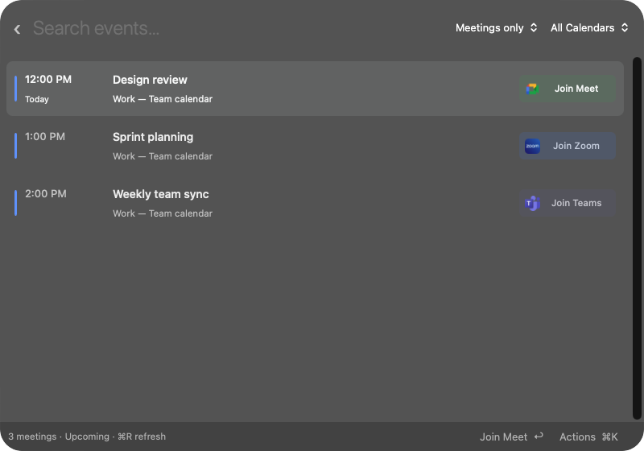
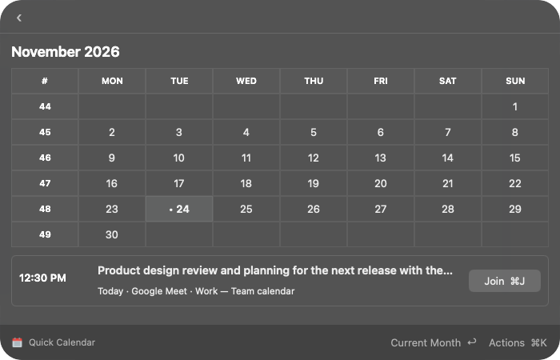
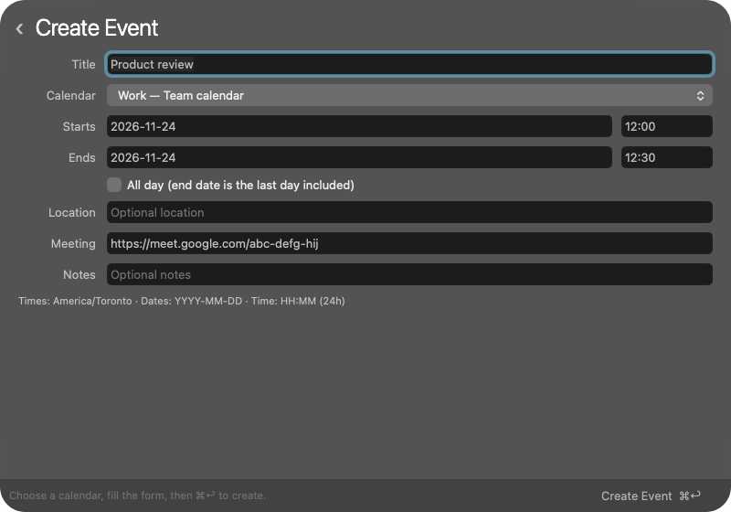

# Calendar for Alfred

A searchable Calendar menu, quick month view, upcoming meetings and event creation using the
accounts already connected to macOS Calendar.

## Usage

Search commands via the `cal` keyword. Type `cal upcoming`, `cal quick` or `cal create` to filter
its menu. `cal create Team sync` opens the event form with that title.

| Command | Direct keyword | Optional argument |
| --- | --- | --- |
| Upcoming Events | `cald` | Search text, or a date such as `2026-12-01` |
| Quick Calendar | `calq` | Month/date such as `2026-12` |
| Create Event | `calc` | Event title, or a date such as `2026-12-01` |

### Upcoming events

Search events across your calendars via the `cald` keyword. Choose a calendar/account in the
picker, move with ↑/↓ and press ↩ to join. The **Meetings only** view is the default: it shows
events with supported meeting links and keeps holidays out of the list. Switch to **Timed events**
for in-person meetings without links, or **All events** to include holidays and all-day entries.
Choose the default in the Workflow's Configuration. Ongoing meetings and recurring occurrences
are included; cancelled events are omitted. The default range is
seven calendar days, including today; choose 1–90 in the Workflow's Configuration.

- <kbd>↩</kbd> Join the meeting, or show its date in Calendar when there is no meeting link.
- <kbd>⌘</kbd><kbd>K</kbd> Open actions: join, copy meeting link, show date in Calendar, copy details, create event.
- <kbd>⌘</kbd><kbd>R</kbd> Reload from macOS Calendar.
- <kbd>⌘</kbd><kbd>O</kbd> Show the selected event's date in Calendar.
- <kbd>⌘</kbd><kbd>N</kbd> Create an event.
- <kbd>⌘</kbd><kbd>F</kbd> Focus search.



Meeting links are recognized in the event URL, location and notes. Supported providers are
Google Meet, Zoom (including Zoom for Government), Microsoft Teams and Webex. If an event has
multiple supported links, choose the intended one. Unrecognized URLs are not opened as meetings.

### Quick Calendar

Browse a month via the `calq` keyword. Today is highlighted; select a date to view its events or
create an event for that day. The month grid works without Calendar permission. Below it, a selected-day preview shows an
ongoing or next meeting today, the earliest meeting on a future day, or the most recent meeting
on a past day. It follows the default agenda filter and stays hidden when there is nothing to
show or calendar access is unavailable. Long titles pause with an ellipsis, then scroll within
their own native label area; macOS Reduce Motion keeps the title static. The preview uses native
theme colours and a transparent background, with no embedded web view. The time, Join control and footer
remain in separate fixed areas.

Click **Join** or press <kbd>⌘</kbd><kbd>J</kbd> to join the previewed meeting.

- <kbd>←</kbd> / <kbd>→</kbd> Previous / next month.
- <kbd>⇧</kbd><kbd>←</kbd> / <kbd>⇧</kbd><kbd>→</kbd> Previous / next year.
- <kbd>↩</kbd>, <kbd>C</kbd> or <kbd>⌘</kbd><kbd>T</kbd> Current month.
- <kbd>⌥</kbd><kbd>←</kbd> / <kbd>⌥</kbd><kbd>→</kbd> Select previous / next day.
- <kbd>↑</kbd> / <kbd>↓</kbd> Move the selected date by a week.
- <kbd>⌘</kbd><kbd>O</kbd> Show events on the selected date.
- <kbd>⌘</kbd><kbd>N</kbd> Create an event on the selected date.
- <kbd>⌘</kbd><kbd>C</kbd> Copy the selected date as YYYY-MM-DD.
- <kbd>⌘</kbd><kbd>↩</kbd> Copy the displayed calendar as a Markdown table.
- <kbd>⌘</kbd><kbd>K</kbd> Open month/year navigation, calendar copying and selected-date actions.



Set Monday/Sunday as the first weekday and toggle ISO week numbers in the Workflow's
Configuration. With Sunday first, the ISO week number follows that row's Monday.

### Create events

Add an event via the `calc` keyword. Choose a writable calendar/account, enter a title and date/time,
and press <kbd>⌘</kbd><kbd>↩</kbd>. The form closes after a successful save. The workflow remembers the last calendar used; the initial
choice is macOS Calendar's default. Read-only calendars are excluded from the creation picker.

Dates use **YYYY-MM-DD**, times use **24-hour HH:MM**, and the form displays your Mac's time zone.
For an all-day event, the end date is the last day included. For example, November 24 to November
24 creates a single all-day event. Invalid dates, reversed ranges and nonexistent daylight-saving
times are rejected. On the fall-back clock change, an ambiguous time follows macOS's date resolution;
check the saved event if you schedule during that repeated hour.

Location, notes and a pasted meeting link are optional. This version does **not** generate new
Meet/Zoom conferences, add invitees or send invitations. Those require additional provider
integration; connecting an account to macOS Calendar does not provide Google/Zoom API credentials.



macOS handles synchronization with your calendar providers. Offline events follow Calendar's
normal syncing behavior. Refresh the form's calendar list with <kbd>⌘</kbd><kbd>R</kbd>.

Use <kbd>⌘</kbd><kbd>[</kbd> or the back button to return to the menu from any view. All four
keywords, the actions/back shortcuts and window mode are configurable.

## Requirements and access

- macOS 14 or later, Alfred 6 with the Powerpack, and Node.js (Bun is a fallback).
- Calendar accounts configured in macOS Calendar for event features.
- Full calendar access: click **Allow Access**, accept the macOS prompt, then refresh. If denied,
  enable the requesting app under **System Settings → Privacy & Security → Calendars**.
  During development the requester may be Codex or Terminal; when launched from Alfred, grant
  Alfred access as requested. <kbd>⇧</kbd><kbd>⌘</kbd><kbd>,</kbd> opens these settings.
- Showing a date in Calendar uses Automation access to Calendar; grant it when prompted.

No API keys, extra CLI tools, runtime downloads, compiled helpers or Accessibility permission are
needed. Loading and saving calendar data uses Apple's EventKit through the built-in JXA runtime.

## Privacy

Event notes are used transiently to find meeting links and are not cached. Event titles, times,
calendar names, locations and meeting links are cached locally for action handling, in a private
0700 directory with 0600 files. Snapshots expire on access after 15 minutes and are replaced on
refresh or cleared after a failed refresh. They are not encrypted and may remain on disk until
accessed or refreshed. Preview requests keep only a request token in the local cache; preview links stay in the current
window’s memory and are cleared when the selected date changes. No calendar data is sent to a server by this workflow; joining a meeting
opens its provider URL. Calendar providers continue their normal macOS sync.

The workflow prints event data only to Alfred's UI; do not share raw debugger output from your
real calendars. Screenshots and bug reports should use demo events.

## Development

From this repository:

```bash
cd workflows/z-cald
bun install --frozen-lockfile
bun run check
bun run package  # dist/Calendar.alfredworkflow
bun run link     # link this checkout into Alfred
```

If the host's Node cannot load native lint bindings, `bun --bun run check` runs the same checks
with Bun. macOS is required for packaging (`plutil`, zsh). Edit `ui/*.ts` and `scripts/plist.ts`,
then rebuild; the generated `workflow/*.alfredui/ui.json` and `info.plist` are tracked.

```
src/                 Calendar/date/link logic and command handlers
ui/                  Alfred UI definitions
scripts/eventkit.js  Plain JXA bridge: JSON over stdin/stdout
scripts/             Build, plist, packaging and development linking
workflow/            Installed workflow, generated windows and launcher
tests/               Date/link/form tests and a fake EventKit bridge (no real writes)
```

See [TESTING.md](TESTING.md) for manual checks and the central [release guide](../../RELEASING.md).
Release tags use `z-cald/vX.Y.Z`.

## Credits

[Raycast Quick Calendar](https://github.com/raycast/extensions/tree/e38232e713cc42a58cac81b8d3af9261fd1624e5/extensions/calendar)
by fuksman, pernielsentikaer and tonka3000 inspired the month navigation and supplies the Calendar
icon, reused under MIT as requested. See [THIRD_PARTY_NOTICES.md](THIRD_PARTY_NOTICES.md).
The Meet, Zoom and Teams badges also use Raycast extension assets under MIT, credited in the
third-party notices. The interface and launcher follow this repository's Bitwarden and VS Code workflows.

## AI disclosure

This workflow was built with the help of AI tools, directed and tested by a human. Review the code
before use, as you would any workflow; please report anything that doesn't work.

## License

[MIT](LICENSE), with the Raycast notice included in every exported workflow.
