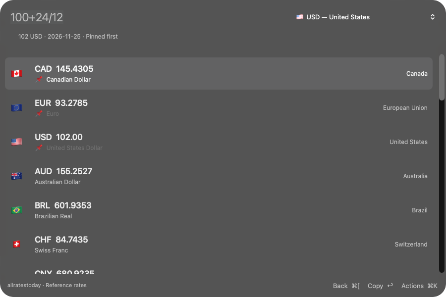
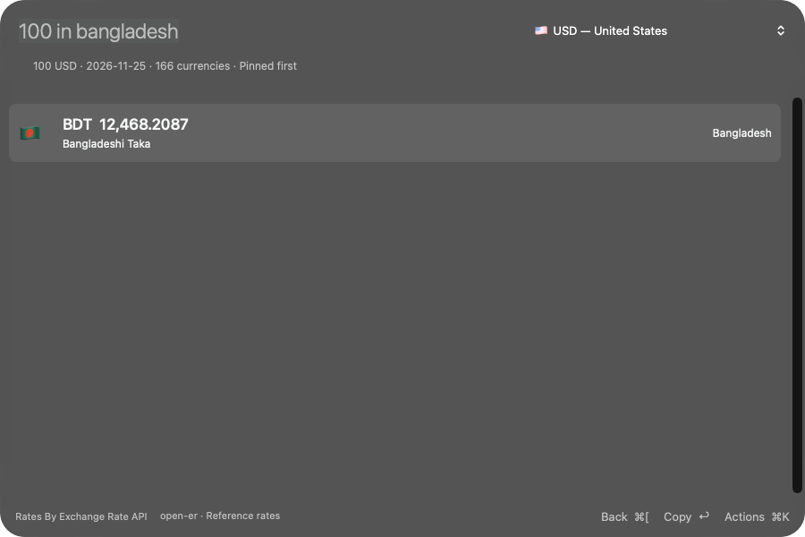

# Currency Exchange for Alfred

Convert amounts and arithmetic expressions, pin target currencies and search by country in Alfred 6.
Inspired by [Raycast Currency Exchange](https://www.raycast.com/xeric/currency-exchange).





Requires macOS, Alfred 6 Powerpack, Node.js 22+ or Bun. The default provider requires no API key and covers 160+ currencies, including BDT.

## Use

- **`currency`** converts 1 unit of the configured base currency.
- **`currency 100+24/12`** converts 102 units.
- **`currency 100 in Bangladesh`** filters targets by currency name, code or country.
- Choose the base currency from the top-right picker. Pinned targets appear first.
- Return copies the selected result with four decimal places; Copy Full Conversion includes both codes
  and the provider's rate date. Display values use up to four decimal places.

Arithmetic supports `+ - * / ^ %` and parentheses. Exponentiation is right-associative; percentages
are fractions, so `(100+20)*50%` is 60. Queries never execute JavaScript.

**⌘K Actions:** Copy to Clipboard, Copy Full Conversion, Pin/Unpin Currency, Set Currency Date,
Use Latest Rates, Refresh Rates, and Rate Provider / API Documentation. ↑/↓ navigate results.
⌘R refreshes. Configurable Back (⌘[) stays visible in every footer, outside Actions; the date sheet
returns to the conversion and the root returns to Alfred search.

## Providers and API keys

Workflow Configuration includes provider, API key, default base currency, keywords and shortcuts.

| Provider | Key | Coverage / history |
| --- | --- | --- |
| ExchangeRate-API Open Access (default) | None | 160+ currencies, daily; no history |
| AllRatesToday ECB reference | None | About 30 currencies, daily reference rates; no history |
| ExchangeRate-API | Required | Broader coverage; history requires a supporting plan |
| UniRateAPI | Required | Broader coverage; history depends on the API and plan |

[ExchangeRate-API setup](https://www.exchangerate-api.com/docs/overview),
[UniRateAPI](https://unirateapi.com),
[ECB endpoint](https://allratestoday.com/api/open/central-bank/ecb).
The native picker lists only currencies actually returned by your provider. A configured base that
is not available is reported explicitly; choose another base or change provider.

Use **Actions → Set Currency Date** or append **`at 2021/9/25`** for history. **Use Latest Rates** clears
it. Unsupported history, quota/key errors and unverified dates show an error. Current rates are never
presented as a historical result. Keyed provider responses are validated but live authenticated
requests need your key and have not been tested in this checkout.

[Open Access documentation](https://www.exchangerate-api.com/docs/free). Rates By
[Exchange Rate API](https://www.exchangerate-api.com). The live table was verified with 166 currencies,
including BDT, PKR, NPR and LKR. ECB remains an optional smaller reference table.

Rates cache for one hour by provider/key/date. Failed refresh falls back only to the same cached table
and marks it stale. Provider timestamps are preserved; if a provider supplies no timestamp, the UI
says so. Fetch time is not substituted for a rate publication time. ECB dates have day precision.
These are reference rates, excluding transaction fees/spreads.

Amounts and target filtering stay local. Providers see your IP and rate date; keyed providers also
receive the configured key over HTTPS. Keys remain in Alfred preferences, may sync with your Alfred
settings, and are excluded from workflow exports/packages. They are never logged or stored in session
state; cached filenames use a hash. Preferences are not a system Keychain store.

## Development

```sh
bun install --frozen-lockfile
bun run check
bun run package
bun run link
```

Output: `dist/Currency Exchange.alfredworkflow`. Tag: `z-currency/vX.Y.Z`.
The `open` external trigger accepts the same query as the keyword for future Swiss integration.
UI/plist are generated from TypeScript. See [TESTING.md](TESTING.md).

## Credits and AI disclosure

MIT icon, currency/country catalog and feature reference: Raycast Currency Exchange by xeric, daudln,
taken and contributors, [pinned source](https://github.com/raycast/extensions/tree/e38232e713cc42a58cac81b8d3af9261fd1624e5/extensions/currency-exchange).
Data belongs to the selected provider. See [THIRD_PARTY_NOTICES.md](THIRD_PARTY_NOTICES.md).
Built with help from AI tools; review before use and report issues on the project tracker.

## Swiss launcher integration

When opened from Swiss, the root Back returns to the same launcher search/selection. Child screens
and sheets still go back one level first. Direct launches keep their normal Back behavior. Install
Swiss separately; it is optional and does not run this tool until selected.

## Data refresh controls

Configure Rates cache / refresh minutes (default 60) and Refresh while open. Expired data refreshes without rebuilding the search field. Hover the status for fetch/provider timestamps. A shorter interval does not change the provider’s publication schedule; open-access rates update daily.
