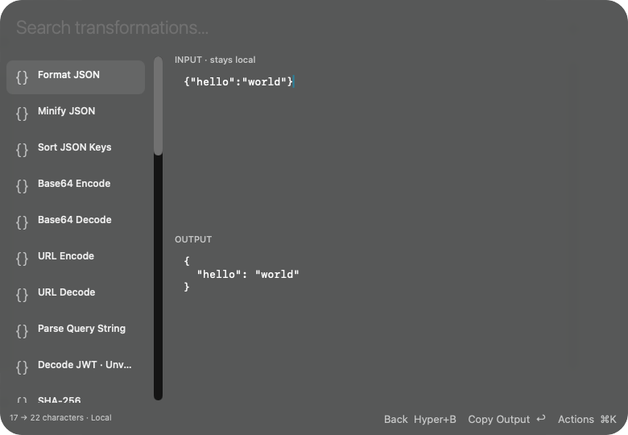

# Dev Utils for Alfred 6

A local developer toolbox: pick an operation, edit the input, copy the output. Nothing leaves your Mac.



Requires macOS, Alfred 6 with Powerpack and Node.js 22+ or Bun.

## Open

Type `devutils`, or choose Dev Utils in `dev`. A searchable list of operations sits beside an
editable **Input** and a read-only **Output**. Opening it with no text reads the clipboard (turn
that off in Configuration).

## Operations

JSON format, minify and key sorting · UTF-8 Base64 · URL encode/decode · query-string parsing
(duplicate keys kept) · JWT decoding · SHA-256, SHA-512, MD5 · UUID · Unix time and dates · case
conversion · line cleanup, sorting and de-duplication · JSON string escapes · HTML entities · text
inspection.

**JWT decoding does not verify signatures or claims. MD5 is only a legacy fingerprint.** All
operations use built-in libraries: no API, subscription or extra app.

Limits: input 50,000 characters / 120 KB, output 120 KB. Invalid input shows an error and leaves the
input untouched.

## Actions (⌘K)

Copy Output, Paste Output, Use Output as Input, Read Clipboard, Clear Input, Open Input in DevUtils
App, DevUtils Website and Configuration. Copy uses exactly the displayed output (including a
generated UUID). Paste needs macOS Accessibility permission. Back (Hyper+B) returns to the Dev
launcher.

## Configuration

<!-- config:start (generated by scripts/readme-config.ts from info.plist; do not edit) -->
Open the workflow in Alfred Preferences → **Configure Workflow**.

| Setting | Default | What it does |
| --- | --- | --- |
| Keyword | `devutils` | Open Dev Utils. |
| Back shortcut | Hyper+B (`⌃⌥⇧⌘B`) | Hyper modifier checkboxes plus a Back key; turn Hyper off to use a custom shortcut instead. |
| Use clipboard on empty invocation | On |  |
| Actions shortcut | `⌘K` | Open actions. |
| Node.js executable | — | Optional absolute executable path. |
| Open window | Inside Alfred |  |
<!-- config:end -->

## Privacy

Input and output are never written to cache or session files, and reach the script through
temporary environment variables, never command arguments. Session files keep only the selected
tool, search and navigation.

## The DevUtils app

The Raycast DevUtils extension launches the separate [DevUtils app](https://devutils.com). The
optional **Open Input in DevUtils App** action uses its `devutils://auto?clipboard` handoff and needs
that app installed. Its advanced tools (language formatters, YAML, QR codes, regex testing) are not
reimplemented here.

## Development

```sh
bun install --frozen-lockfile
bun run check
bun run package
bun run link
```

Width, Back and footer follow [UI_CONVENTIONS.md](../../UI_CONVENTIONS.md).

## Credits and AI disclosure

References: [Raycast DevUtils](https://github.com/raycast/extensions/tree/18750b5bc7fe87eb76991e86f0cda47200daa48f/extensions/devutils/),
the Alfred Text Transformer workflow and [DevUtils](https://devutils.com). Independent
implementation; no third-party code or binaries bundled. See
[THIRD_PARTY_NOTICES.md](THIRD_PARTY_NOTICES.md). Built with help from AI tools.
