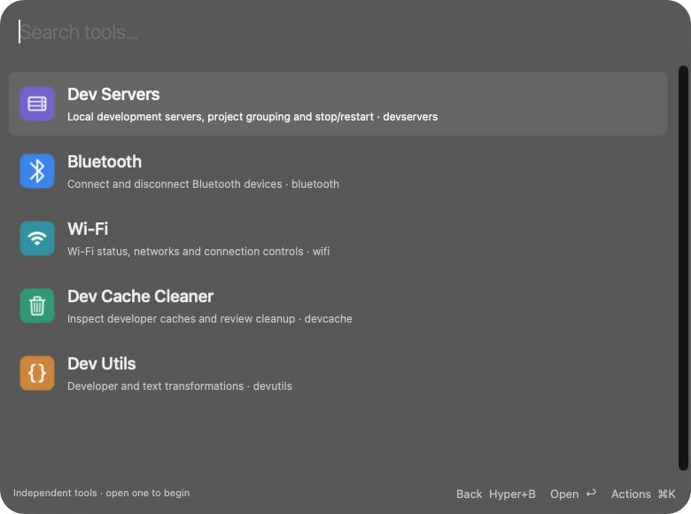

# Dev launcher for Alfred 6

Type `dev` to search and open independently installed Dev Servers, Bluetooth, Wi-Fi, Dev Cache Cleaner and Dev Utils. These tools are separate from Swiss. No Password Generator is included; use Bitwarden’s existing generator.

Each tool retains a standalone keyword. Back from a tool returns to this launcher with its previous search/selection. Back at the launcher returns to Alfred search. Missing/outdated tools are marked and never launched. Command-K offers Open Tool, Copy Default Shortcut, Refresh Installed Tools and Download Workflows.

Standard 780 width and configurable Hyper+B follow UI_CONVENTIONS.md. Build with `bun run check` and `bun run package`; install locally with `bun run link`. Built with help from AI tools.

## Configuration

<!-- config:start (generated by scripts/readme-config.ts from info.plist; do not edit) -->
Open the workflow in Alfred Preferences → **Configure Workflow**.

| Setting | Default | What it does |
| --- | --- | --- |
| Dev keyword | `dev` | Find and open your independent tools. |
| Actions shortcut | `⌘K` | Open launcher actions. |
| Back shortcut | Hyper+B (`⌃⌥⇧⌘B`) | Hyper modifier checkboxes plus a Back key; turn Hyper off to use a custom shortcut instead. |
| Open window | Inside Alfred | Choose Alfred’s window or a separate window. |
| Node.js executable | — | Optional absolute path if automatic discovery fails. |
<!-- config:end -->
