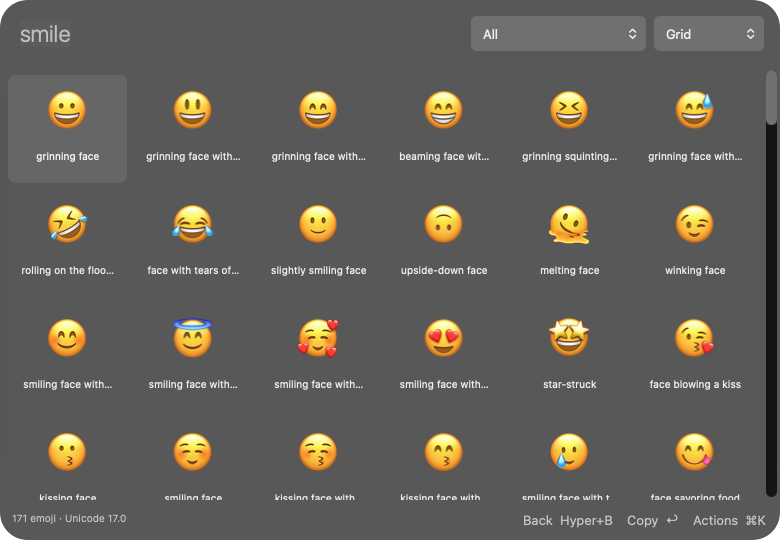

# Emoji Picker for Alfred 6

Offline emoji search with **3,944 fully-qualified Unicode 17.0 sequences**, favourites, recents,
skin tones, and a list or grid layout.


Requires macOS, Alfred 6 with Powerpack and Node.js 22+ or Bun.

## Search

Type `emoji`, or open it from Swiss. Search names, categories, the emoji itself or descriptive
shortcodes. The category picker has **Favorites**, **Recent** and the Unicode groups. Large result
sets show the first 500 matches with a `500+` indicator; narrow the search or pick a category.

Choose **List** or **Grid** above the results; the layout is remembered and switching keeps the
search, category and selection. Arrow keys move through the grid.



## Actions

- **↩** copies the emoji (Configuration can make it paste instead).
- **⌘K**: Copy, Paste, Add/Remove Favorite, Skin Tone / Variants, Copy Descriptive Shortcode,
  Emojipedia and Configuration.
- Variants open a child list; **Back** (Hyper+B) restores the previous filter, category and selection,
  and from the first screen returns to Swiss when opened there.

Recents keep the latest 80 distinct picks. Favourites and recents stay on your Mac.

## Notes

- Shortcodes are generated from Unicode names; they don't promise compatibility with a chat app's
  aliases.
- The whole dataset (flags and skin-tone sequences included) is bundled: no API call or download.
- Newer emoji need a macOS font that has them; lower **maximum emoji version** in Configuration if
  you see blank squares.
- Paste uses System Events ⌘V, so Alfred needs Accessibility permission.

## Configuration

<!-- config:start (generated by scripts/readme-config.ts from info.plist; do not edit) -->
Open the workflow in Alfred Preferences → **Configure Workflow**.

| Setting | Default | What it does |
| --- | --- | --- |
| Keyword | `emoji` | Open Emoji Picker. |
| Back shortcut | Hyper+B (`⌃⌥⇧⌘B`) | Hyper modifier checkboxes plus a Back key; turn Hyper off to use a custom shortcut instead. |
| Return action | Copy |  |
| Maximum emoji version | `17` | Use an older version if your macOS font does not display newer emoji. |
| Actions shortcut | `⌘K` | Open actions. |
| Node.js executable | — | Optional absolute executable path. |
| Open window | Inside Alfred |  |
<!-- config:end -->

## Development

```sh
bun install --frozen-lockfile
bun run check
bun run package
bun run link
```

Tests cover catalogue coverage, joined and skin-tone sequences, shortcode search, favourite/recent
order and Back restoration; no real clipboard is changed. Width, Back and footer follow
[UI_CONVENTIONS.md](../../UI_CONVENTIONS.md).

## Credits and AI disclosure

Data: [Unicode emoji-test 17.0](https://www.unicode.org/Public/17.0.0/emoji/emoji-test.txt),
redistributed under the included Unicode license. Behaviour inspired by
[Raycast Emoji](https://github.com/raycast/extensions/tree/e38232e713cc42a58cac81b8d3af9261fd1624e5/extensions/emoji/);
no reference code or artwork copied. Workflow and icon MIT. See
[THIRD_PARTY_NOTICES.md](THIRD_PARTY_NOTICES.md). Built with help from AI tools.
