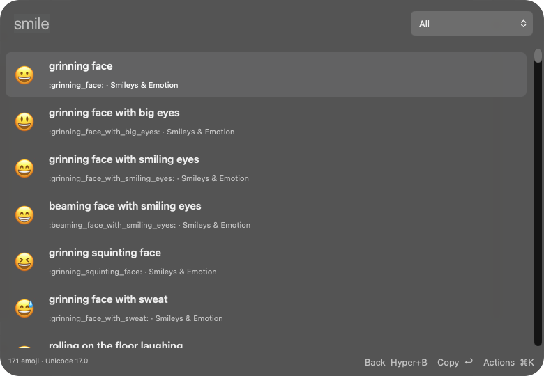

# Emoji Picker

Offline native Alfred 6 emoji search with **3,944 fully-qualified Unicode 17.0 sequences**. Open `emoji` or use Swiss. Search descriptions, categories, emoji characters and descriptive shortcodes. The category picker includes Favorites, Recent and Unicode groups.



Return copies the selected emoji by default; Configuration can make it paste instead. Actions includes Copy, Paste, Add/Remove Favorite, Skin Tone / Variants, Copy Descriptive Shortcode, Emojipedia and Configuration. Variants open a child list; Back restores the previous filter/category/selection. Recents store the latest 80 distinct selections. Favorites and recents stay local.

Shortcodes are descriptive identifiers generated from Unicode names, not a promise of compatibility with a particular chat application's aliases. Search is word-based; for a large result set the first 500 matches are displayed with a `500+` indicator. Narrow the search or choose a category to reach later entries. The full dataset is bundled, including country flags and skin-tone sequences; there is no runtime API call or download.

Newer Unicode emoji depend on your installed macOS font. Set a lower maximum emoji version in Workflow Configuration when a character is unsupported. Paste uses Alfred's normal downstream handoff and System Events Command-V; Alfred needs Accessibility permission for that action.

Windows use the shared 780-point width, clamped to the display. Back defaults to Hyper+B and remains visible outside Actions. Configuration includes the Hyper toggle, all four modifier checkboxes, the Back key and a custom shortcut. A root Back restores Swiss when launched there.

```sh
bun install
bun run check
bun run package
bun run link
```

Tests cover catalog coverage, joined/tone sequences, shortcode search, persistent favorite/recent ordering and exact Back restoration. No real user clipboard is changed by the tests.

Data: [Unicode emoji-test 17.0](https://www.unicode.org/Public/17.0.0/emoji/emoji-test.txt), redistributed under the included Unicode license. Behavior inspired by [Raycast Emoji](https://github.com/raycast/extensions/tree/e38232e713cc42a58cac81b8d3af9261fd1624e5/extensions/emoji/); no reference code or artwork copied. Workflow/icon MIT. Built with help from AI tools.

Shared UI: windows use the 780-point reference width with active-display clamping. Back defaults to Hyper+B (Control + Option + Shift + Command + B); Configuration includes the Hyper toggle, four modifier checkboxes, Back key and custom shortcut. Footer labels use Hyper+B. Existing explicit custom Back shortcuts remain active until Hyper configuration is explicitly saved.

Choose **List** or **Grid** above the results. The layout is remembered; switching keeps the current search, category and selected emoji. Arrow keys navigate the tile grid.
