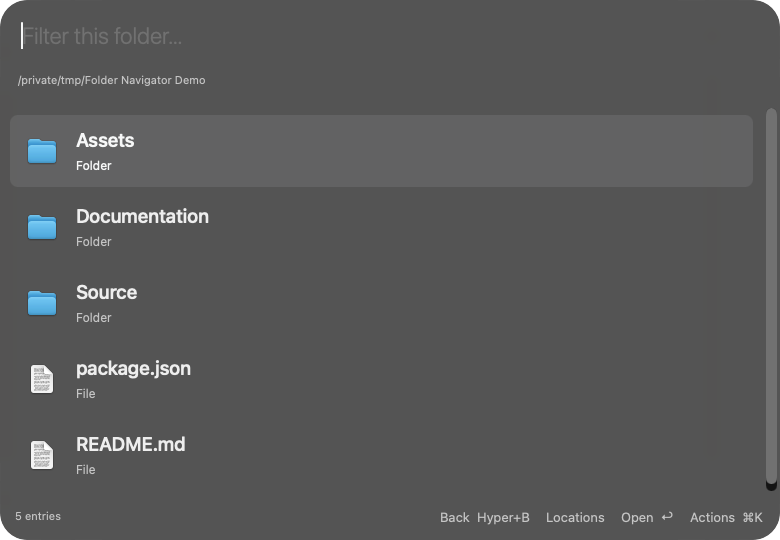
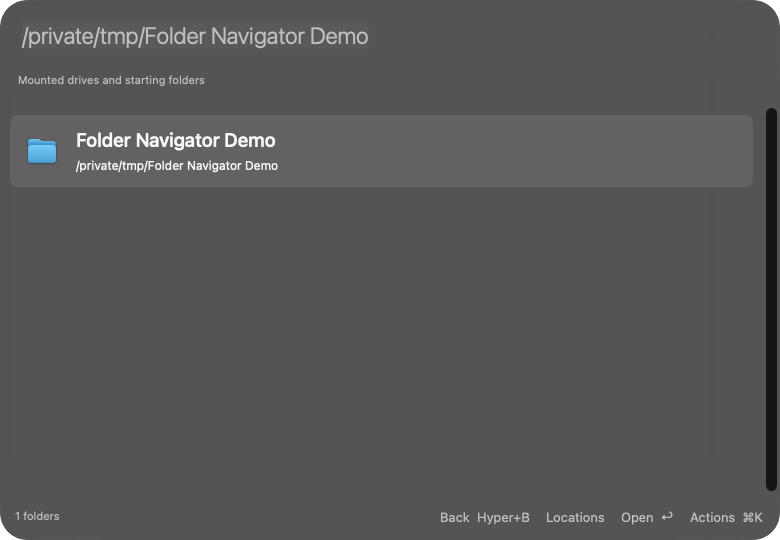

# Folder Navigator

Search for a folder, then keep browsing its files and subfolders in a native Alfred window. Launch with **`folders`**, or choose **Folder Navigator** in Swiss.

Requires macOS, Alfred 6 Powerpack, and Node.js 22+ or Bun. Inspired by the installed [Dynamic File Search workflow](https://github.com/alfredapp/dynamic-file-search-workflow/).

## Find and browse

The first screen searches indexed **folder names** through Spotlight. Enter an absolute path or a `~/` path to find a known folder directly. Before typing, the list shows **mounted drives (including external SSDs)** followed by configured starting folders. Enter a drive to browse it directly.

Press Return to browse a folder. Inside it, typing filters its immediate children; Return descends into another folder or opens a file in its default app. Application/document packages open normally. Choose **Show Package Contents** to browse one deliberately. Rows use the actual macOS file/folder icons.

Hyper shortcuts are enabled by default. Workflow Configuration has four modifier checkboxes, a Back key field and a custom shortcut used when Hyper is disabled. Footer labels use the compact “Hyper+B” form.

Back is visible outside Actions with a configurable default of **Hyper+B** (Control + Option + Shift + Command + B). It restores the preceding folder/search, its query and selected row. It retraces the UI history rather than jumping directly to the filesystem parent. **Enclosing Folder** is a separate action. A root Back returns to the saved Swiss search/selection, or to Alfred search for a direct launch.

## Actions

**⌘K** includes Browse/Open, Open in Finder/Default App, Reveal in Finder, Get Info, Copy Path, Open Terminal Here and All Alfred File Actions. The native File Actions handoff offers applicable installed integrations; it leaves this UI for Alfred’s built-in actions. Folder-history restoration applies to this navigator’s own screens.

While browsing, Actions also offers Open Current Folder in Finder, Enclosing Folder, Search Nested Folders and Search All Folders. Refresh (⌘R), the dotfile toggle and Configuration remain available without a selected row. The dotfile toggle controls names beginning with a dot, rather than every Finder visibility flag.

## Locations and limits

The visible **Locations** button opens Workflow Configuration. Add SSD paths to **Search locations** for folder-name search, or **Starting folders** for direct shortcuts. For example, `~;/Volumes/My SSD/Projects` searches Home plus a project folder on that drive. Mounted drives appear automatically unless their checkbox is disabled.

Workflow Configuration controls the keyword, Back/Actions shortcuts, search locations, initial folders and initial dotfile visibility. Locations are semicolon-separated absolute or `~/` paths. Defaults search Home and `/Volumes`; Spotlight must index those locations. Full-path lookup and browsing use the filesystem directly.

Search is bounded to 300 displayed folder matches; a directory view loads up to 2,000 matching entries. Limited-result messages suggest narrowing the query. Filtering happens before the directory limit, so narrowing the filter can find an entry beyond the original displayed subset. Unreadable/disappeared entries are skipped; a directory read error leaves Back available. No folder contents are indexed or sent to a network service by this workflow.

Listings refresh on navigation, filter changes and explicit Refresh. Old requests and outgoing-view selection events cannot replace a newer navigation level. Search changes update the existing controls rather than rebuilding/refocusing the text field.

## Build and validation

```sh
bun install --frozen-lockfile
bun run check
bun run package
bun run link
```

The build generates `ui.json` and `info.plist`. Tests use disposable files/directories and mocked navigation, without opening or modifying user files. See [TESTING.md](TESTING.md).

## Credits

The folder icon comes from Alfred’s Dynamic File Search workflow, BSD-3-Clause. Its full notice is bundled in [THIRD_PARTY_NOTICES.md](THIRD_PARTY_NOTICES.md). The navigation/search implementation is independent. Built with help from AI tools.





Shared UI: windows use the 780-point reference width with active-display clamping. Back defaults to Hyper+B (Control + Option + Shift + Command + B); Configuration includes the Hyper toggle, four modifier checkboxes, Back key and custom shortcut. Footer labels use Hyper+B. Existing explicit custom Back shortcuts remain active until Hyper configuration is explicitly saved.
