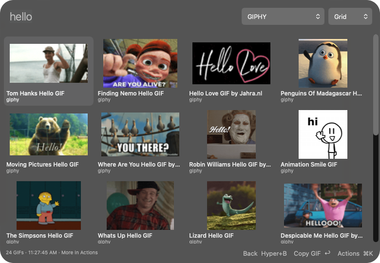

# GIF Search for Alfred 6

Requires macOS, Alfred 6 with Powerpack and Node.js 22+ or Bun.

## Search

Search animated GIFs from the standalone `gifsearch` keyword or Swiss. Choose **List** or **Grid** from the dropdown beside the provider. The layout is remembered. Search typing stays focused; changing layout preserves the search, source and selection.

## Actions

Command-K offers Copy GIF, Copy GIF Link, Copy Markdown, Paste Markdown, favorite/unfavorite, animated Details, Copy Page Link, Open in Browser, Download GIF, Load More, Refresh and Configuration. Return defaults to copying the actual GIF file; change it in Workflow Configuration. Downloads use unique filenames in Downloads. Details has its own visible Back action; closing it returns to the same results. Hyper+B returns to Swiss with its previous search/selection, or Alfred search when invoked independently.

## Providers and refresh

GIPHY and Klipy use the public service endpoints used by the pinned Raycast reference. No bundled API key is used. These third-party endpoints are not guaranteed for Alfred. The GIPHY reference endpoint returned real results during verification. Klipy pagination is limited to the first page. Finer GIFs Club is a smaller searchable catalog with no trending feed; its live endpoint returned HTTP 530 during verification and errors remain visible. Switch provider if a service is unavailable.

Choose **GIPHY direct** to use the official GIPHY API with your own key: **Actions (⌘K) → Set GIPHY API Key…**. The key is kept in your macOS Keychain (service `com.izsk.gif-search`), never in Alfred's preferences, search caches or command arguments; **Remove GIPHY API Key** deletes it. A key saved by an earlier version is moved to the Keychain automatically. GIPHY search is limited to 50 characters. Results are cached for five minutes by default; configure 0–60 minutes, or Command-R to fetch now. A failed refresh reports an error and keeps existing results instead of presenting them as newly fetched. Favorites/recent GIF metadata stays local. Network searches go to the selected provider; previews load from its media host.

List, grid and Details all use Alfred's native image view, which plays the GIF animation (no web view). GIF files are downloaded on explicit Copy/Download, limited to 30 MB and checked for GIF content. No cleanup or dependency installation runs automatically.

## Configuration

<!-- config:start (generated by scripts/readme-config.ts from info.plist; do not edit) -->
Open the workflow in Alfred Preferences → **Configure Workflow**.

| Setting | Default | What it does |
| --- | --- | --- |
| Keyword | `gifsearch` | Open GIF Search. |
| Back shortcut | Hyper+B (`⌃⌥⇧⌘B`) | Hyper modifier checkboxes plus a Back key; turn Hyper off to use a custom shortcut instead. |
| GIF provider | GIPHY (reference service) |  |
| Search cache (minutes) | `5` | 0 always fetches; Command-R refreshes immediately. Maximum 60 minutes. |
| Return action | Copy GIF file |  |
| Actions shortcut | `⌘K` | Open actions. |
| Node.js executable | — | Optional absolute executable path. |
| Open window | Inside Alfred |  |
<!-- config:end -->

## Development

Run `bun run check`, `bun run package`, then `bun run link` for development installation. Node.js or Bun is required. Standard width 780, screen-aware clamping, configurable Hyper modifiers and compact footer labels follow [UI_CONVENTIONS.md](../../UI_CONVENTIONS.md).

## Credits and AI disclosure

Built with help from AI tools. Reference: [Raycast GIF Search](https://github.com/raycast/extensions/tree/dccfc8877dd0e658295cb4b6d29b4a0a1b79baf8/extensions/gif-search/). Provider behavior and actions informed this independent implementation. [GIPHY API documentation](https://developers.giphy.com/docs/api/endpoint/).
