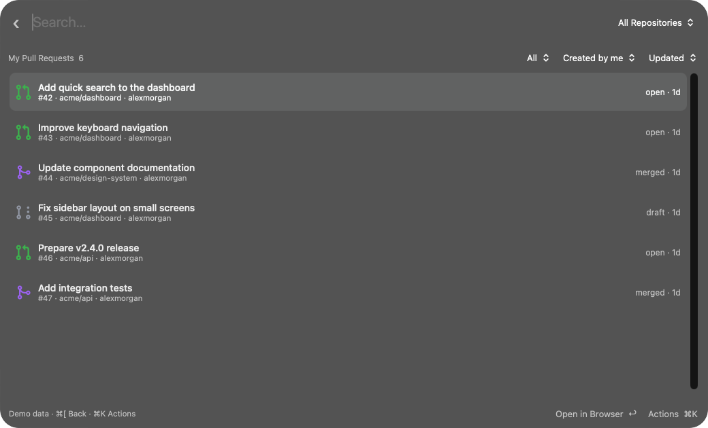
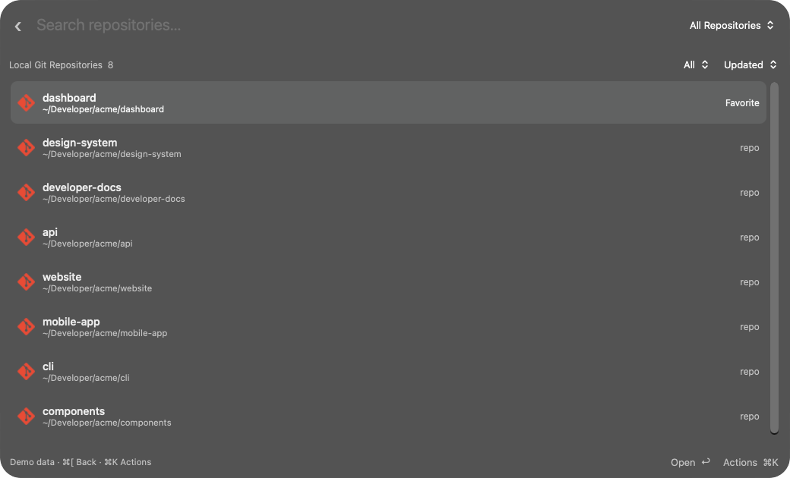

# GitHub & Git

Work with GitHub activity and local repositories from Alfred 6. This combines the GitHub and Git
Repos extensions referenced below, with a full-history My Pull Requests view and a per-repository
My Pull Requests action. Raycast menu-bar features are excluded.

## Setup

Requires macOS, Alfred 6 Powerpack, Node.js or Bun, and an existing [GitHub CLI](https://cli.github.com/)
installation for online features. Local scanning and opening repositories do not require GitHub authentication.

```sh
brew install gh
gh auth login
```

The workflow uses GitHub CLI’s existing login and Keychain integration. It does not ask for or store
a token. Permissions depend on your account and token: private repositories need repository access,
notifications need `notifications`, packages need `read:packages`, and Projects need `project`.
Add only scopes for features you intend to use, for example `gh auth refresh -s notifications`.
Enterprise users can configure their GitHub hostname and authenticate `gh` for it.

Set your local repository scan folders in Workflow’s Configuration, one absolute or `~/` path per
line. Configure the default clone folder and application there too. Open `dist/GitHub.alfredworkflow`
after building to install it; `bun run link` installs a development symlink.

## Usage

Search the combined command menu via the `github` keyword. Open your pull requests via the `myprs`
keyword, or local repositories via the `gitrepos` keyword. All keywords are configurable.



My Pull Requests defaults to all statuses and PRs you authored, across repositories. Choose Open,
Draft, Merged, Closed or All; switch between created, assigned, mentioned, review-requested,
reviewed and involved relationships. There is no two-week history cutoff. Load More fetches the
next page. GitHub search limits each query to 1,000 results; refine by repository or date if needed.

Select any GitHub repository and use **⌘K → My Pull Requests in This Repository** to reuse that view with its repository
filter. The All Pull Requests in This Repository action displays everyone’s PRs in that repository.

| Keys | Action |
| --- | --- |
| <kbd>↩</kbd> | Open the selected item in its browser or default local application |
| <kbd>⌘</kbd><kbd>K</kbd> | Open actions for the selected item |
| <kbd>⌘</kbd><kbd>[</kbd> | Return to the main Alfred search from every view or sheet |
| <kbd>⌘</kbd><kbd>R</kbd> | Refresh from GitHub or rescan local folders |
| <kbd>⌘</kbd><kbd>C</kbd> | Copy the selected URL |
| <kbd>⌘</kbd><kbd>D</kbd> | Show details |
| <kbd>⌘</kbd><kbd>↩</kbd> | Continue or submit a form |

Back and Actions shortcuts are configurable. Every Back action closes the workflow UI and returns
to the main Alfred search. Escape remains Alfred’s own dismiss action.

The menu provides repository search, latest/starred repositories, PR and issue search, My Issues,
notifications, workflow runs and dispatch, discussions, projects, packages and versions. Repository
actions include README, issues, PRs, releases, discussions, Actions, web IDEs, cloning and ZIP downloads.

PR actions include reviews, requested reviewers, commits/diff, checkout, labels/assignees, milestones,
projects, merge methods, auto-merge, merge queues, ready-for-review, closing/reopening and Vercel
preview links when present. Merging includes the selected head SHA and never uses an admin bypass.
Issue actions include comments, assignment, labels, projects, milestones, issue types, linked branches
and completed/not-planned close reasons. Actions runs can be rerun, rerun for failed jobs, cancelled
or deleted. Notifications can be read, completed, unsubscribed or accepted as invitations.

Creation forms cover repositories, PRs, issues, branches and releases. Advanced fields appear on the
next form page. Assignees, labels and reviewers use comma-separated names; projects use
`owner/number`. Workflow dispatch accepts its input values as a JSON object. Clone options support
HTTPS/SSH Git URLs; ZIP download supports a complete ref or one directory within it.

## Local repositories



Scan normal repositories, linked worktrees and optional submodules. Favorites sort first, then
recently opened repositories. Search by repository name/path and filter by repository type.
Open in any configured application, all configured applications, Finder or a chosen application.
Remote submenus open code, issues and PRs on the remote host; nested groups and explicit ports
are retained. Local GitHub repositories also have a My Pull Requests action.

Copy Path copies the local path. Copy Alfred Quicklink copies an `alfred://` trigger URL that opens
the repository using this workflow. This is the Alfred counterpart of Raycast’s quicklink action.

Remove Repository checks for uncommitted/untracked files and commits missing from known remote
refs, then asks before moving the folder to Trash. Force Remove explicitly skips those checks.
Linked worktrees and submodules must be removed with Git instead. Remote-tracking refs describe
the last fetch, so fetch/push before removing a repository if you need current remote status.

## Privacy and limits

Private GitHub responses and local navigation state are cached in this workflow’s private cache;
no credentials are included. Downloads and clones write only to the destination you select.
Creation, reviews and other write actions occur only when selected or submitted. Destructive actions
show a confirmation. No runtime dependencies are installed automatically.

API permissions, organization policies, branch protection and GitHub service limits still apply.
Repository and branch selectors load paginated API results.
The UI uses Alfred’s theme; the screenshots show illustrative data, not a live account.

## Development

```sh
bun install --frozen-lockfile
bun run check
bun run package
```

Edit `ui/window.ts` and `scripts/plist.ts`; generated `ui.json` and XML `info.plist` are rebuilt by
`bun run build`. Runtime code uses Node’s standard library, Git, GitHub CLI and macOS utilities.
See [TESTING.md](TESTING.md) for automated and manual verification.

## Credits

Adapted from [Raycast GitHub](https://github.com/raycast/extensions/tree/00ddc630b0c8ba7e3136fff1ad5b200796a6ef65/extensions/github)
and [Git Repos by Dean Moore](https://github.com/raycast/extensions/tree/dccfc8877dd0e658295cb4b6d29b4a0a1b79baf8/extensions/git-repos).
Source icons are retained; monochrome SVGs receive embedded fills because Alfred file images do
not apply Raycast’s icon tinting. MIT notices are included in [THIRD_PARTY_NOTICES.md](THIRD_PARTY_NOTICES.md).

## AI disclosure

This workflow was built with the help of AI tools. Review the code before use, as you would any
workflow; please report anything that does not work.
