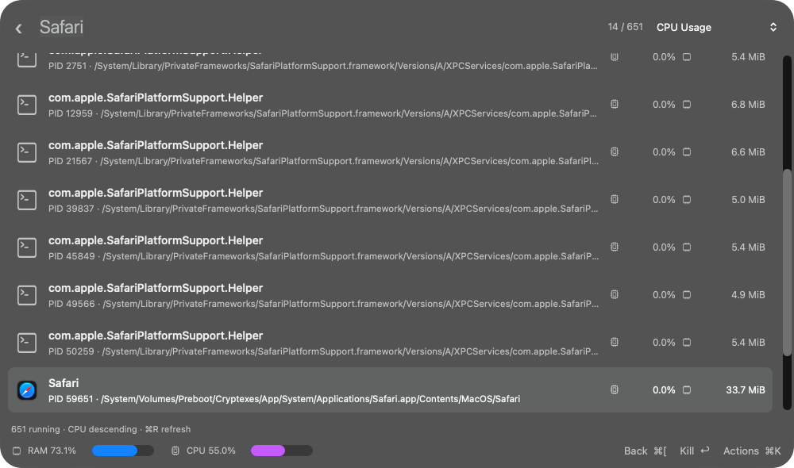

# Kill Process for Alfred

Find running processes, compare CPU/memory usage, and terminate or restart apps from a native Alfred
window. Inspired by [Raycast Kill Process](https://www.raycast.com/rolandleth/kill-process), with live
CPU and RAM bars in the footer.

Requires macOS, **Alfred 6 with Powerpack**, and Node.js 22+ or Bun. Uses macOS’s built-in `ps`, `top`,
`vm_stat`, `sysctl` and `open`. No external CLI installation, network service or background daemon.



## Usage

Type **`kill`** to open the list, or **`kill Safari`** / **`kill 12345`** to start with a query. Change the
keyword in Workflow Configuration. Search matches names, PIDs and optionally executable paths.
Use the picker for CPU Usage or Memory Usage, highest first. Arrow keys navigate; long paths truncate
with a tooltip. App processes use their Finder icons; other processes use a terminal symbol.

| Shortcut | Action |
| --- | --- |
| Return | Review Kill (SIGTERM) |
| ⌘K | Actions for the selected process |
| ⌘Return | Force Kill (SIGKILL) |
| ⌥⌘R | Restart app |
| ⌥⇧⌘R | Force Restart app |
| ⌥Return | Kill All matching the exact executable |
| ⌥⇧Return | Force Kill All matching the exact executable |
| ⌥⌘C | Copy Path |
| ⌘R | Reload |
| ⌘F | Focus search |
| ⌘[ | Back: close a sheet to its parent; from the list return to Alfred search |

The complete **Actions / ⌘K** menu includes Kill, Force Kill, Restart, Force Restart, Kill All,
Force Kill All, Copy Path, Copy PID, Show Details, Show in Finder, Reload, pause/resume auto-refresh,
and Open Activity Monitor. Restart entries appear only for identifiable app bundles. Back is always
visible in the footer and is kept outside the Actions menu.

## Live usage

The default interval is three seconds **between samples**, with roughly one extra second for the
system CPU sample. Configure 1–60 seconds, or 0 for manual refresh. Polling exists only while the
window is open; closing it deletes the current process snapshot and pending confirmation. No tool
is started merely by installing the workflow. Refresh preserves search, sorting and selected PID
as long as that process still matches.

- **Process CPU:** macOS `ps`’s CPU estimate; a multithreaded process can exceed 100%.
- **Process memory:** resident set size (RSS), including shared pages. Values are not added together
  to estimate overall RAM.
- **Footer CPU:** the latest `top` sample, normalized across all cores to 0–100%.
- **Footer RAM:** active + wired + compressed physical pages divided by installed RAM. File-cache
  pages are excluded. This differs from Activity Monitor’s memory-pressure measure.

Unavailable metrics show a dash. Hover over meters for definitions and used/total RAM.

## Process actions

Normal Kill requests termination with SIGTERM; Force Kill sends SIGKILL immediately and can lose
unsaved work. All actions show a review sheet by default. You can disable confirmation for a single
normal Kill; force, group and restart actions always require review.

**Kill All** means the exact executable path of the selected process, not everything matching your
search. The review lists all target PIDs; newly started processes are never added after confirmation.
A plan expires after one minute and is single-use. PID, start time, owner and executable identity
are checked again before signaling. macOS does not offer an atomic signal-by-PID-and-start-time API,
so a very small race remains between the final identity check and sending the signal.

**Restart** requests termination of the processes inside the selected app bundle, waits up to five
seconds for those targets to exit, and opens the app again. If the app is still running (for example,
a Save dialog), it does not launch again. Background processes have no reliable restart recipe and
are not restarted. Relaunching an app does not restore custom command-line arguments.

The workflow does not elevate privileges. Other users’ processes, key macOS services and the current
workflow’s ancestor processes are protected. An action can fail because of permissions or a process
exiting; the status line reports the error. SIGTERM being sent is not a claim that an app has exited.

## Development and installation

```sh
bun install --frozen-lockfile
bun run check
bun run package
bun run link
```

Open `dist/Kill Process.alfredworkflow` to install, or use the development link. UI and plist files are
generated from `ui/window.ts` and `scripts/plist.ts`. See [TESTING.md](TESTING.md) for validation.
Independent release tags use `z-kill-process/vX.Y.Z`. The external trigger `open` accepts a search query;
Swiss integration will be handled separately after the individual workflows are complete.

## Credits and AI disclosure

The icon and action inspiration are from [Raycast Kill Process by rolandleth and contributors](https://github.com/raycast/extensions/tree/3e9e8cf4594e19ce5939a7bbdb7f19a90a719397/extensions/kill-process), MIT.
See [THIRD_PARTY_NOTICES.md](THIRD_PARTY_NOTICES.md) and [LICENSE](LICENSE).

This workflow was built with the help of AI tools. Review it before use and report issues on the
[project tracker](https://github.com/sk-izsk/z-alfred-workflow/issues).
