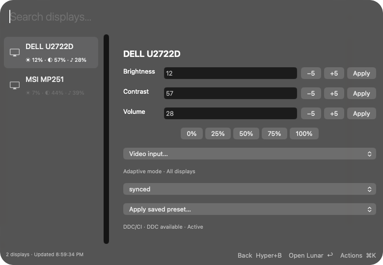

# Lunar Controls for Alfred 6

Brightness, contrast, volume, video input, adaptive mode and presets for your displays, through the
separately installed [Lunar](https://lunar.fyi) app.



Requires macOS, Alfred 6 with Powerpack, Node.js 22+ or Bun, and Lunar with its current CLI.

## Open

Type `lunarui`, or choose Lunar Controls in Swiss. Search or select a display (selecting never opens
the Lunar app), then:

- drag the **brightness**, **contrast** and **volume** sliders: the label follows as you drag and the
  display changes when you release;
- use the brightness buttons (0/25/50/75/100%);
- pick a **video input** (from the inputs Lunar reports for that display), the **adaptive mode**
  (manual, synced, sun, system, ambient or auto) or a **saved preset**.

Adaptive modes and presets are global; numeric changes target the selected display.

## Actions (⌘K)

Save New Preset (existing names are refused, so nothing is overwritten), Power On, Power Off (after a
review), Lunar Night Mode (Lunar's warmer colour mode, not macOS Night Shift), Open Lunar, Refresh
and Configuration. Back (Hyper+B) works even while the slider panel has focus, and returns to Swiss
when opened there.

## Notes

- Needs the Lunar CLI with `displays --json`, `set`, `adaptive` and `preset`. It is found in
  `~/.local/bin`, Homebrew and common app paths, or set its path in Configuration. Lunar is never
  installed or modified; an older CLI shows an error.
- A display may reject a control it doesn't support; unavailable values stay blank and the DDC
  support and control method are shown.
- Values refresh on opening, on selection, on Refresh and after a change, never while you drag.
- The slider panel is a local web view inside Alfred (native Alfred UI has no slider); it loads
  nothing from the internet.

## Configuration

<!-- config:start (generated by scripts/readme-config.ts from info.plist; do not edit) -->
Open the workflow in Alfred Preferences → **Configure Workflow**.

| Setting | Default | What it does |
| --- | --- | --- |
| Keyword | `lunarui` | Open Lunar Controls. |
| Back shortcut | Hyper+B (`⌃⌥⇧⌘B`) | Hyper modifier checkboxes plus a Back key; turn Hyper off to use a custom shortcut instead. |
| Lunar executable | — | Optional absolute CLI path. Requires the current Lunar CLI with displays --json support. |
| Additional preset names | — | Optional semicolon-separated names if your Lunar version uses a different preset listing format. |
| Actions shortcut | `⌘K` | Open actions. |
| Node.js executable | — | Optional absolute executable path. |
| Open window | Inside Alfred |  |
<!-- config:end -->

## Development

```sh
bun install --frozen-lockfile
bun run check
bun run package
bun run link
```

Tests cover response parsing, input limits, CLI arguments and preset names; they never change
brightness, inputs, power or presets. Width, Back and footer follow
[UI_CONVENTIONS.md](../../UI_CONVENTIONS.md).

## Credits and AI disclosure

References: the Lunar-fred workflow and the Lunar CLI's help. No proprietary binaries, reference
code or artwork redistributed. Workflow and icon MIT; see [THIRD_PARTY_NOTICES.md](THIRD_PARTY_NOTICES.md).
Built with help from AI tools.
