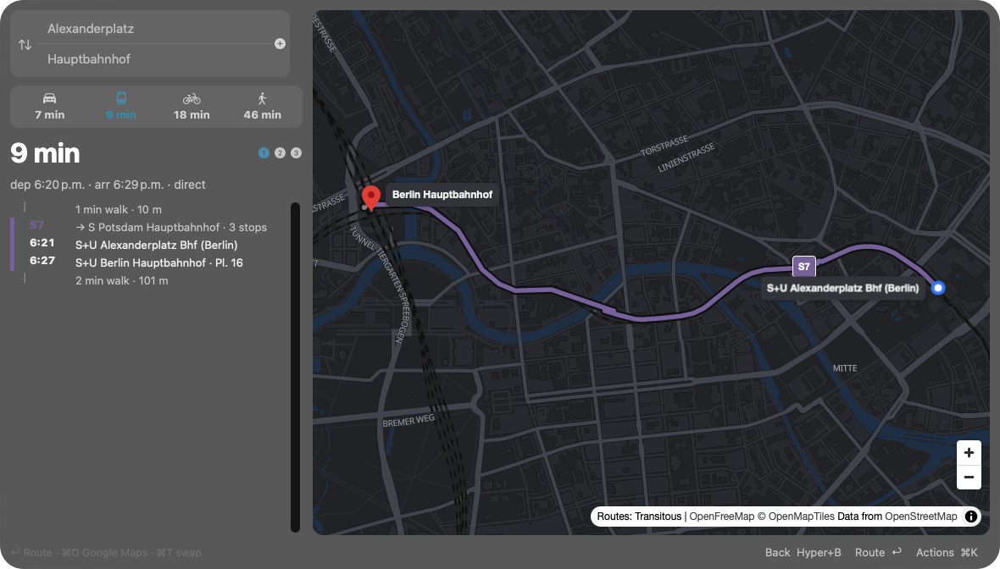
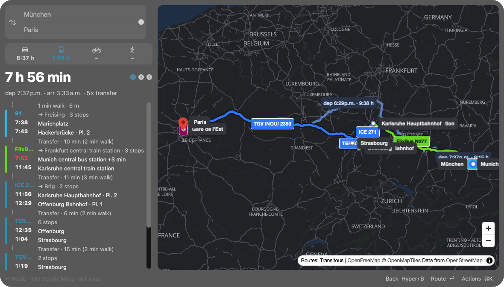

# Maps for Alfred

Routes and place search on a live map inside Alfred 6: car, transit, bike and walk, with stops,
alternatives and a full transit itinerary. Open data by default, no API key. HERE is optional
with your own key.





Requires macOS, Alfred 6 with Powerpack, Node.js 22+ or Bun, and an internet connection.

## Search

| Type | Opens |
| --- | --- |
| `maps Eiffel Tower` | The place on the map |
| `maps A > B` or `maps from A to B` | A route |
| `maps A > B > C` or `maps from A via B to C` | A route with stops (up to three) |
| `maps von A über B nach C` | The same in German |
| `maps` with an address on the clipboard | A route from Home (if set) to the copied address |

`home` (also `zuhause`, `daheim`) and `work` (also `office`, `arbeit`, `büro`) use the addresses
from Workflow Configuration. Saved places work by their label, so `maps gym > work` routes
between two saved places. Other workflows can open a route with the External Trigger `route`
and an argument like `Start > Destination`.

Places are found near the start: with `Alexanderplatz > Hauptbahnhof`, the destination is the
Hauptbahnhof nearest to Alexanderplatz. The start itself is searched near **Search near** in
Configuration, or the city of your Mac's time zone.

## Keys

| Key | Does |
| --- | --- |
| ↩ | Route. ↩ again (nothing changed) opens the route in Google Maps |
| ⌘O | Open the route in Google Maps, Apple Maps, OpenStreetMap or HERE WeGo (Configuration) |
| ⌘1 – ⌘4 | Car, transit, bike, walk |
| ⌘T | Swap From and To |
| ⌘U / ⇧⌘U | Add a stop / remove the last stop |
| ⌘K | Actions: open in another map app, copy link, save the destination as a place, remove saved places, clear |
| Hyper+B | Back to Alfred's search (configurable, shown in the footer) |

The opened link carries the addresses you typed (home and work expanded), the stops and the
mode, so Google Maps shows the same trip. OpenStreetMap directions take two points, so stops
are left out there.

## Window

The sidebar has From and To with a round + for stops, optional Home, Work and saved-place
buttons, the four modes with their times, the travel time with alternatives 1–3, the
departure and arrival line, and for transit the itinerary: coloured line bars, platforms,
transfers and delays in red.

The map shows the chosen route over a casing, walking parts dotted, a line badge for each ride,
transfer stops, the start (blue ring), stops (black ring) and the destination (red pin).
Alternatives are light blue with a time chip where they leave the chosen route; click a line or
chip to choose it. Scroll, pinch and double-click zoom; the map does not rotate. Labels follow
Google Maps: countries, regions, seas and cities in your language, streets and smaller places in
the local name, and non-Latin names with the Latin form above them.

The window is 1180 × 620 points by default (Window width and Map height in Configuration,
limited to the screen). This is wider than the repository's 780-point standard because the map
needs the room; see [UI_CONVENTIONS.md](../../UI_CONVENTIONS.md).

## Data, providers and privacy

| | Open data (default) | HERE (your key) |
| --- | --- | --- |
| Places | Transitous, Photon as fallback | HERE Geocoding & Search |
| Transit | Transitous (up to 3 connections, earliest arrival first) | HERE Public Transit |
| Car, bike, walk | Transitous times; FOSSGIS OSRM alternatives | HERE Routing (car times include traffic) |
| Map | OpenFreeMap with MapLibre GL, recoloured light/dark | HERE map tiles (day/night) |

- With HERE selected but no key, open data is used and the footer says so.
- FOSSGIS OSRM is asked at most once per second, as its usage policy requires. Alternatives for
  a mode are fetched when you switch to it; with stops, all three modes are fetched.
- Transitous asks heavy users for a contact; set **Contact e-mail** to send it in the
  User-Agent. Nothing else about you is sent.
- Transit with stops is planned leg by leg, each departing after the previous arrival.
- Cache: routes 10 minutes, failed requests 60 seconds, places 7 days, in Alfred's workflow cache.
  Saved places live in Alfred's workflow data folder. Your HERE key, addresses and saved places
  are marked as not exported with the workflow.
- Places, stops and route coordinates you search for are sent to the providers above. The map
  page loads MapLibre from unpkg (jsDelivr as fallback).

## Configuration

Keyword (`maps`), provider and HERE key, Open in (⌘O), default mode, Home and Work addresses,
saved places (`Label = address`, one per line), quick buttons, clipboard destination, language
(automatic, English, Deutsch), Search near, map colours (automatic, dark, light), route line
scale, stop names, font sizes, window width, map height, contact e-mail, Actions and Back
shortcuts and the Node.js path. Times, 12/24-hour clock and units follow macOS. Changes apply
the next time the window opens.

## Development

```sh
bun install --frozen-lockfile
bun run check
bun run package
bun run link
```

The package is `dist/Maps.alfredworkflow`. `ui/window.ts` and `scripts/plist.ts` generate
`ui.json` and `info.plist`. `src/main.ts` is the command-line entry
(`zmap <command> <from> <to> <stop1> <stop2> <stop3> [extra]`), printing one JSON action per run.
Visible actions answer from the cache at once; the `route` command then does the network work
in the background and drops its answer if a newer action happened meanwhile. Map pages are
written to four rotating files so the web view reloads, and a click on an alternative reloads
the page with `?alt=N&t=…`, which the `pick` command handles once per address.

Tests use synthetic places and a mocked network. Releases use `z-map/vX.Y.Z`.

## Credits and AI disclosure

Layout, keys and map behaviour follow the brief for the "Open Maps 1.1.4" Alfred workflow; no
code from it was available or copied. Routing by [Transitous](https://transitous.org) and
[FOSSGIS OSRM](https://routing.openstreetmap.de), places by Transitous and
[Photon](https://photon.komoot.io), map by [OpenFreeMap](https://openfreemap.org) and
[MapLibre GL JS](https://maplibre.org), data © OpenStreetMap contributors. Optional
[HERE](https://www.here.com) services with your key. See
[THIRD_PARTY_NOTICES.md](THIRD_PARTY_NOTICES.md) and [LICENSE](LICENSE).

This workflow was built with the help of AI tools. Review it before use and report issues on the
[project tracker](https://github.com/sk-izsk/z-alfred-workflow/issues).
