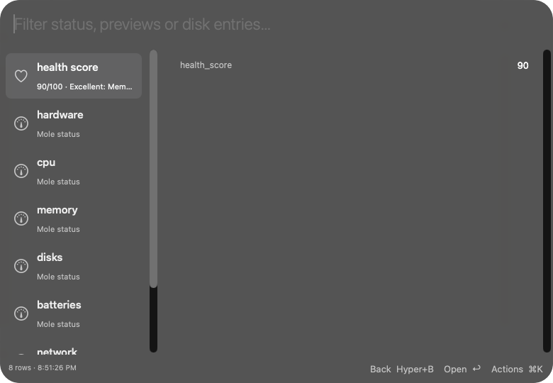

# Mole for Alfred 6

System health, disk usage, cleanup and optimisation previews from the installed
[Mole CLI](https://mole.fit), in native Alfred views.



Requires macOS, Alfred 6 with Powerpack, Node.js 22+ or Bun, and the Mole CLI.

## Open

Type `moleui`, or choose Mole in Swiss. Each command is its own level; Back (Hyper+B) restores the
previous menu or folder, filter and selection.

- **System Status** (`mole status --json`): a sectioned sidebar with value badges and scrollable
  details. ↩ refreshes.
- **Disk Usage** (`mole analyze --json <folder>`): ↩ goes into a folder or opens a file; ⌘K has
  Reveal in Finder. Set the starting folder in Configuration (e.g. `/Volumes/My SSD`).
- **Clean System** (`mole clean --dry-run`): grouped rows with the total size, item count and per-item
  sizes.
- **Optimize System** (`mole optimize --dry-run`): grouped rows with the available optimisations.

## Cleaning and optimising

Opening a preview never cleans anything. After a successful preview, an explicit review action opens
the real command in your terminal, where Mole shows its own confirmations and password prompts. The
workflow never elevates privileges, hides Mole's prompts, or reports success just because the
terminal opened. Refresh the preview after making changes.

Terminal actions use **Terminal application** in Configuration: Ghostty, Terminal, iTerm2, kitty,
WezTerm, Alacritty or a custom command (JSON array with `{command}` and `{cwd}`).

## Notes

- Mole is found in Homebrew paths, or set its path in Configuration. It is never installed or updated
  here; an incompatible response shows an error.
- Previews run in a background worker with a busy indicator, elapsed time and Mole's latest line;
  scans time out after 90 seconds and 8 MB of output. Disk lists show the first 500 entries, previews
  the last 600 lines.
- Alfred's embedded window can hide when another app takes focus; choose **Separate window** in
  Configuration for a window that stays.

## Configuration

<!-- config:start (generated by scripts/readme-config.ts from info.plist; do not edit) -->
Open the workflow in Alfred Preferences → **Configure Workflow**.

| Setting | Default | What it does |
| --- | --- | --- |
| Keyword | `moleui` | Open Mole. |
| Back shortcut | Hyper+B (`⌃⌥⇧⌘B`) | Hyper modifier checkboxes plus a Back key; turn Hyper off to use a custom shortcut instead. |
| Terminal application | Ghostty | Used for terminal commands and Open Terminal Here. Install the selected terminal separately. |
| Custom terminal executable | — | Only used when Custom executable is selected. |
| Custom terminal arguments (JSON) | `["-e","/bin/zsh","-lc","{command}"]` | JSON argument array. {command} is the command plus an interactive shell; {cwd} is the working folder. No shell interpolation is applied to the argument array. |
| Mole executable | — | Optional absolute path. Existing Homebrew locations are detected; nothing is installed automatically. |
| Disk analysis starting folder | `~` | Includes external paths such as /Volumes/My SSD. |
| Actions shortcut | `⌘K` | Open actions. |
| Node.js executable | — | Optional absolute executable path. |
| Open window | Inside Alfred |  |
<!-- config:end -->

## Development

```sh
bun install --frozen-lockfile
bun run check
bun run package
bun run link
```

Tests cover the command allow-list, dry-run flags, shell quoting and parsing. Real cleanup and
optimisation were not run against a user system. Width, Back and footer follow
[UI_CONVENTIONS.md](../../UI_CONVENTIONS.md).

## Credits and AI disclosure

Behaviour reference: [Raycast Mole](https://github.com/raycast/extensions/tree/459326f4f557692a79246dba2d013746f56d724b/extensions/mole/).
No reference code or artwork copied. MIT; see [THIRD_PARTY_NOTICES.md](THIRD_PARTY_NOTICES.md).
Built with help from AI tools.
