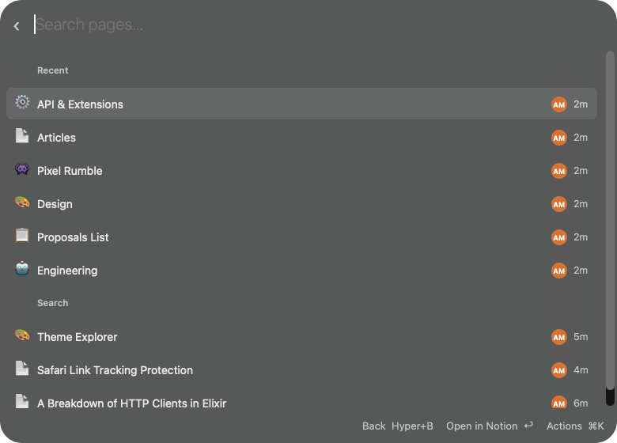
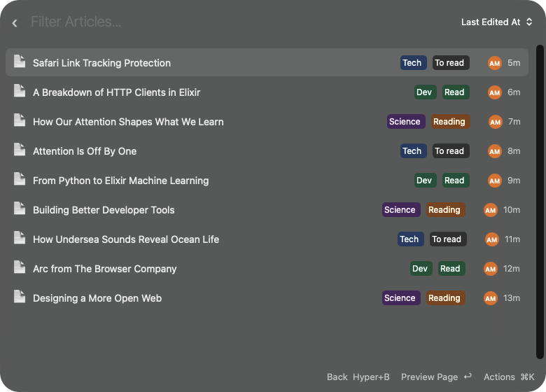
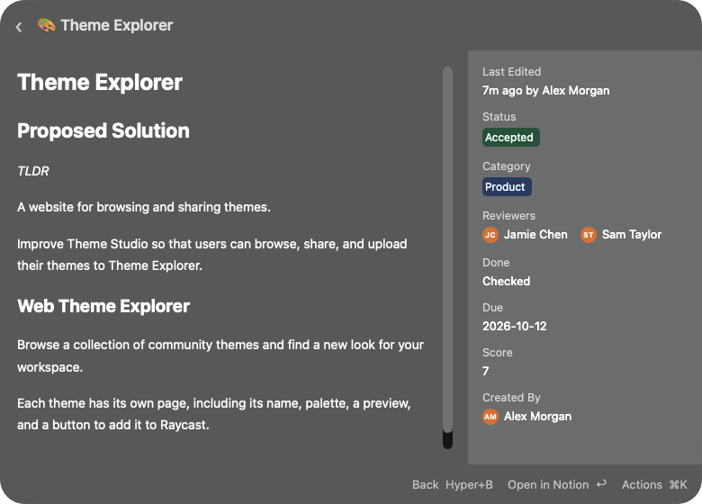
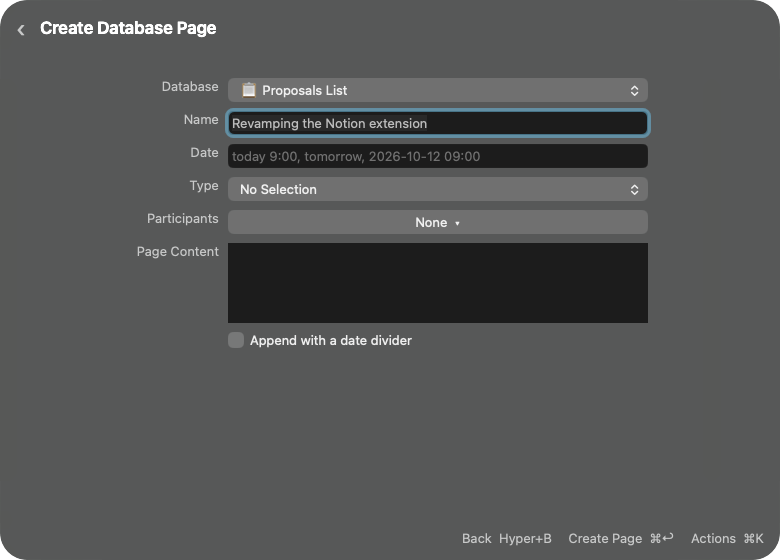
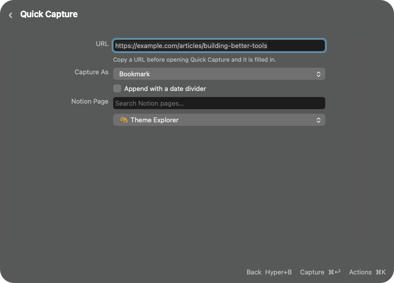

# Notion for Alfred

Search, preview and open Notion pages and databases, create database pages, capture web pages,
add notes and append text, in a native Alfred 6 window. A port of the
[Raycast Notion extension](https://www.raycast.com/notion/notion) by Henri Chabrand and
contributors.





Requires macOS, Alfred 6 with Powerpack, Node.js 22+ or Bun, a Notion workspace and an internet
connection. Screenshots use made-up pages and people.

## Connect

The first time you open it, the window asks for an integration secret:

1. Open [notion.so/my-integrations](https://www.notion.so/my-integrations) and create a new
   **internal** integration for your workspace (any name, e.g. "Alfred").
2. Under **Capabilities**, keep Read, Update and Insert content, and enable **Read user
   information** (for names and initials). Save.
3. Copy the **Internal Integration Secret** and paste it into the window. It is stored in your
   macOS Keychain (service `com.izsk.notion`), not in Alfred's preferences.
4. In Notion, open each top-level page or database you want here and choose
   **⋯ → Connections → add your integration**. Child pages are included.

**Actions → Manage Notion Connection** shows the workspace, tests the connection, replaces the
secret or disconnects (removing the secret and the cache). Raycast's browser sign-in (OAuth) is
specific to Raycast; the internal integration is the equivalent here.

## Search Notion (`notion`)

**Pinned**, **Recent** and **Search** sections, newest first, with icon, title, the last editor's
initials and how long ago. Typing searches Notion page and database titles.

- ↩ previews the page in Alfred (or opens it in Notion, see Configuration); on a database it lists its pages. Open in Notion is ⌘O and in Actions (⌘K).
- In a database: filter by title, sort by **Last Edited At** or **Last Created At**, show property
  tags, and switch between **List** and **Kanban** (grouped by status) in Actions.



**Actions (⌘K)** on a page: Preview Page, Open in Notion (⌘O) or Browser, **Edit Property**
(checkbox, select, status, multi-select and people, from a menu), Append Content to Page,
Create New Page (⌘N, in a database), Pin / Unpin, Visible Properties and View Type (databases),
Copy Page URL, Copy Formatted URL (`[title](url)`), Copy Page Title, Show/Hide Metadata (preview),
Delete (moves to Notion's trash, after asking), Refresh (⌘R) and Manage Notion Connection.

## Create Database Page (`ncreate`)



Choose a database; the form shows a field for each property: text, number, URL, email and phone
fields, a date field (`today 9:00`, `tomorrow`, `2026-10-12 09:00`; no time means a whole day),
checkboxes, pickers for select and status, and ticked menus for multi-select, people and
relations. Page content takes Markdown. ⌘↩ creates the page. Configuration can fill the name or
content from the clipboard and close the window afterwards.

## Quick Capture (`ncapture`)



A copied URL is filled in. Capture it as a **Bookmark**, the **Full Page** (title link plus the
readable text, extracted with Mozilla Readability) or a plain **Link**, optionally after a date
divider, into a page (appended) or a database (as a new page). Type above the page picker to find
other pages.

## Add Note (`nnote`) and Add Text to Page (`nadd`)

- **Add Note** writes into today's page (`NOTES › 2026-11-26`) inside your notes page, creating
  both when needed, as a bullet, to-do or paragraph. Notion can't create top-level pages, so the
  first time choose the page the notes page should be created in.
- **Add Text to Page** appends Markdown to a page, or puts it at the top, optionally after a date
  divider.

Text after a keyword fills the form: `nnote buy milk`, `nadd Meeting went well`.

## Configuration

Keywords, Primary action (Preview, the default, or Open in Notion), Open pages in (Notion app or browser),
Create Database Page options (close after create, clipboard), Notes page name, daily page title
format (`yyyy`, `MM`, `MMM`, `dd`), note style, Actions and Back shortcuts, and the Node.js path.
External Triggers `search`, `create`, `capture`, `note`, `text` and `connect` open each screen.

Back (Hyper+B by default) goes back one screen; from the first screen it returns to Alfred's search.

## Differences from Raycast

Raycast AI tools, "Summarize Page with AI", Quicklinks and Paste actions rely on Raycast itself
and are not included. Everything else in the extension's six commands is here.

## Development

```sh
bun install --frozen-lockfile
bun run check
bun run package
bun run link
```

The package is `dist/Notion.alfredworkflow`. `ui/window.ts` and `scripts/plist.ts` generate the
window shell and `info.plist`; screens are built at runtime by `src/screens.ts`, the Notion API
layer is `src/notion.ts`. Tests use synthetic data. Releases use `z-notion/vX.Y.Z`.

## Credits and AI disclosure

Feature design, behaviour, colours and icon from the
[Raycast Notion extension](https://github.com/raycast/extensions/tree/459326f4f557692a79246dba2d013746f56d724b/extensions/notion)
by Henri Chabrand and contributors (MIT). Uses the official Notion SDK, Martian, notion-to-md,
Mozilla Readability and linkedom. See [THIRD_PARTY_NOTICES.md](THIRD_PARTY_NOTICES.md) and
[LICENSE](LICENSE). Not affiliated with Notion Labs.

This workflow was built with the help of AI tools. Review it before use and report issues on the
[project tracker](https://github.com/sk-izsk/z-alfred-workflow/issues).
