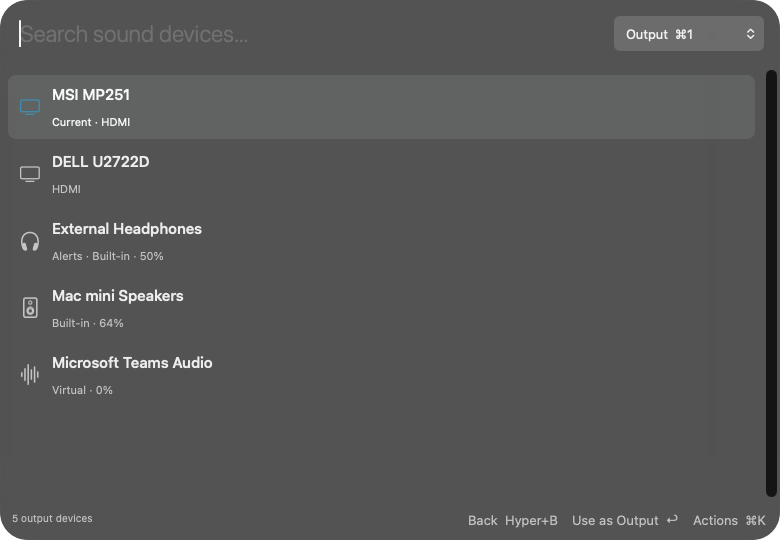

# Sound for Alfred 6

Choose the sound output or input device in a native Alfred window. Speakers, headphones, displays,
AirPlay and Bluetooth devices, USB microphones and virtual devices are listed with their volume.



Requires macOS 13+, Alfred 6 with Powerpack and Node.js 22+ or Bun. Nothing else to install.

## Open

Type `sound`, or choose Sound in Swiss. The current device is listed first and marked **Current**;
type to filter by name or connection (`usb`, `bluetooth`, `hdmi`…). Type `sound in` to open on input
devices, or switch with the picker, **⌘1** (output) and **⌘2** (input).

## Actions

- **↩** switches to the selected device and closes the window.
- **⌘↩** switches and keeps the window open, to try several devices.
- **⌘L** plays alert sounds on the selected output device.
- **⌘K**: Use as Output/Input, Keep Open, Use for Alert Sounds, Copy Device Name, Show Input/Output
  Devices, Open Sound Settings, Refresh and Configuration.
- **Back** (Hyper+B) returns to Swiss when opened there, otherwise to Alfred's search.

## How it works

- Devices come straight from macOS (CoreAudio) through a small JavaScript for Automation script that
  ships with the workflow: no helper app, no permission prompt, about 0.2 s per list.
- Switching the output also moves alert sounds to it, as the Sound settings do. Turn this off with
  **Alert sounds** to keep alerts on their own device.
- Sound lists the devices macOS has right now. A device made by an app, such as BoomAudio from
  Boom 3D, appears while that app is running. AirPlay speakers and TVs become devices only once
  chosen, so pick them in Control Center; after that they show here while in use.
- Hide devices you never use (for example a virtual meeting device) with **Hidden devices**. A hidden
  device still shows while it is in use.

## Configuration

<!-- config:start (generated by scripts/readme-config.ts from info.plist; do not edit) -->
Open the workflow in Alfred Preferences → **Configure Workflow**.

| Setting | Default | What it does |
| --- | --- | --- |
| Keyword | `sound` | Open Sound. Type “in” after it for input devices. |
| Open on | Output devices | Which devices the window shows first. ⌘1 and ⌘2 switch. |
| Alert sounds | On | Off: alerts stay on their own device (⌘L sets it). |
| Hidden devices | — | Device names to leave out, one per line (a hidden device still shows while in use). |
| Back shortcut | Hyper+B (`⌃⌥⇧⌘B`) | Hyper modifier checkboxes plus a Back key; turn Hyper off to use a custom shortcut instead. |
| Actions shortcut | `⌘K` | Open actions. |
| Node.js executable | — | Optional absolute executable path. |
| Open window | Inside Alfred |  |
<!-- config:end -->

## Development

```sh
bun install --frozen-lockfile
bun run check
bun run package
bun run link
```

Width, Back and footer follow [UI_CONVENTIONS.md](../../UI_CONVENTIONS.md).

## Credits and AI disclosure

Original code and icon; see [THIRD_PARTY_NOTICES.md](THIRD_PARTY_NOTICES.md). Built with help from AI
tools, directed and tested by a human. Review the code before use, as you would any workflow; please
report anything that doesn't work.
