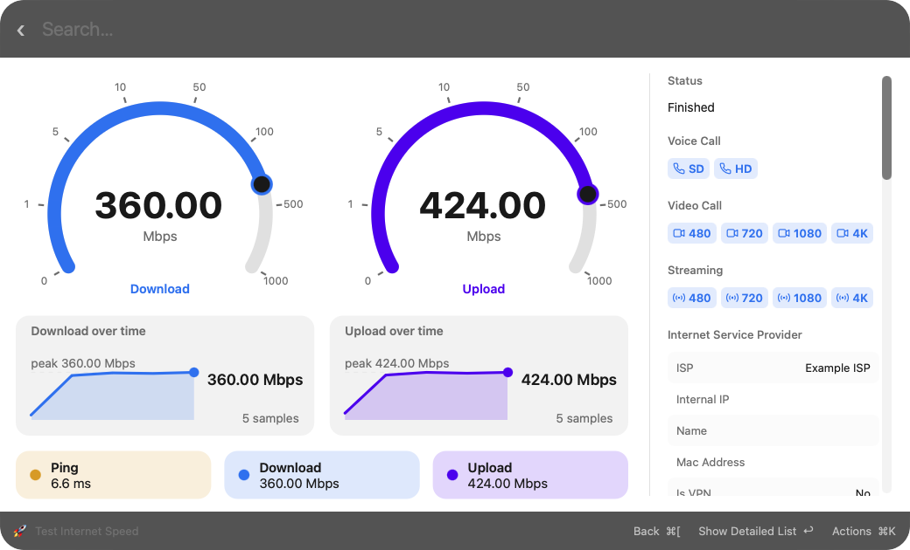
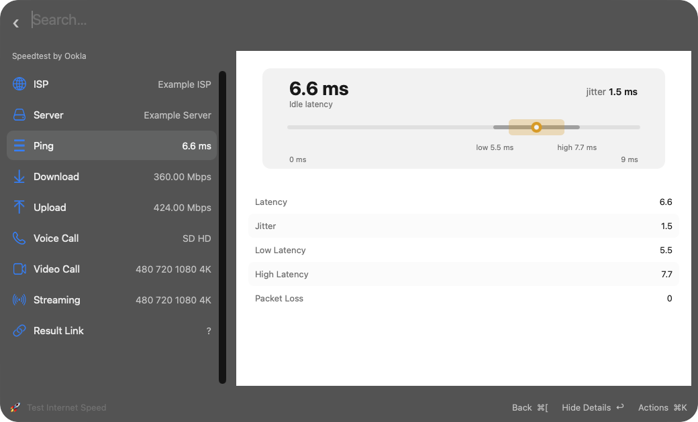

# Speed Test

Live Ookla download and upload meters for Alfred 6, with the dashboard and detailed list adapted
from Raycast Speedtest. The meters, sample charts, phase strip, quality tags, selected-section
charts and offline screen follow the supplied reference design. Alfred supplies the window,
search field, selectable list and action menu, so its theme and controls affect the final appearance.

## Setup

Requires macOS, Alfred 6 with Powerpack, Node.js or Bun, and the **official Ookla Speedtest CLI**.
Install the CLI yourself from [Ookla](https://www.speedtest.net/apps/cli). The Python package named
`speedtest-cli` is incompatible. The workflow detects `/opt/homebrew/bin/speedtest` and
`/usr/local/bin/speedtest`; set a different absolute executable path in Workflow’s Configuration.
No executable is bundled, installed or downloaded by this workflow.

With Homebrew, use [Ookla’s official tap](https://github.com/teamookla/homebrew-speedtest):

```sh
brew tap teamookla/speedtest
brew install teamookla/speedtest/speedtest
speedtest --version
speedtest
```

Review the agreements when prompted. Run `which speedtest` to find a custom executable path.

Open `dist/Speed Test.alfredworkflow` after building to install it.

Starting a test accepts Ookla’s [EULA](https://www.speedtest.net/about/eula) and
[GDPR terms](https://www.speedtest.net/about/gdpr), matching the source extension. Tests contact
Ookla and test servers, consume bandwidth and may create shareable results with connection data.
Frequent runs can hit Ookla’s rate limit. Local snapshots include IP addresses and network metadata;
use Clear CLI Cache to remove them.

## Usage




Test your connection via the `speedtest` keyword. A test starts immediately. The workflow remembers
your last meter/list choice. Configure the Hotkey to launch the same window.

| Key or action | Behavior |
| --- | --- |
| <kbd>⌘</kbd><kbd>L</kbd> | Switch between speed meter and detailed list |
| <kbd>↩</kbd> | Show detailed list, toggle section details, or restart an error |
| <kbd>⌘</kbd><kbd>R</kbd> | Restart after the current test finishes or fails |
| <kbd>⌘</kbd><kbd>K</kbd> | Open Actions |
| Search, <kbd>↑</kbd>, <kbd>↓</kbd> | Filter and select detailed-list sections |
| <kbd>⌘</kbd><kbd>C</kbd> | Copy summary |
| <kbd>⇧</kbd><kbd>⌘</kbd><kbd>C</kbd> | Copy selected section JSON; whole result on the meter |
| <kbd>⌥</kbd><kbd>↩</kbd> | Open result in browser |
| <kbd>⌘</kbd><kbd>D</kbd> | Copy meter PNG |
| <kbd>⇧</kbd><kbd>⌘</kbd><kbd>V</kbd> | Close the window and paste meter PNG into the previous app |
| <kbd>⇧</kbd><kbd>⌘</kbd><kbd>D</kbd> | Save meter PNG to Downloads without overwriting |
| <kbd>⌃</kbd><kbd>X</kbd> | Confirm Clear CLI Cache |
| <kbd>⌘</kbd><kbd>[</kbd> or back button | Return to the main Alfred search |
| <kbd>⎋</kbd> | Close the window and cancel its test |

ISP, server, ping, download, upload, voice calls, video calls, streaming and result sections include
raw metadata and charts where appropriate. Quality thresholds match the source; they estimate
bandwidth suitability and do not guarantee call quality. Raw bandwidth is bytes/second, elapsed is
milliseconds, and displayed speeds convert to bits/second.

Image rendering uses macOS QuickLook and `sips`. Paste uses System Events and requires Accessibility
permission for Alfred. Clear CLI Cache removes this workflow’s snapshots and exported cache image;
it preserves the separately installed CLI. Raycast’s original cache action removes its automatically
downloaded CLI, which this workflow does not maintain.

Chart appearance can be Automatic, Light or Dark in Workflow’s Configuration. Automatic uses Alfred’s
theme background; select an explicit appearance if the theme cannot be detected. Keyword, action
shortcut, executable paths and window mode are configurable there too.



## Development

```sh
bun install --frozen-lockfile
bun run check
bun run package
```

`ui/window.ts` generates `workflow/speedtest.alfredui/ui.json`; `scripts/plist.ts` generates the XML
`info.plist`. Do not edit generated files directly. `bun run link` links the workflow into your
Alfred preferences for development. `scripts/icon.swift` draws the original workflow icon.
See [TESTING.md](TESTING.md) for verification and remaining on-screen checks.

## Credits

Adapted from [Raycast Speedtest](https://github.com/raycast/extensions/tree/c4e0f79975a011e16032382f2d1263f712f8b43c/extensions/speedtest)
by Michael Aigner (tonka3000) and contributors. SVG chart code, activity thresholds, formatting and
action behavior are adapted under MIT; see [THIRD_PARTY_NOTICES.md](THIRD_PARTY_NOTICES.md).
Ookla Speedtest CLI is separately licensed and is not redistributed. The icon is original.
Raycast’s AI tool API is host-specific and is not part of the Alfred workflow.

## AI disclosure

This workflow was built with the help of AI tools. Review the code before use, as you would any
workflow; please report anything that does not work. Automated checks do not replace trying the
window in Alfred.

Back is configurable in Workflow’s Configuration and defaults to **⌘[**. Every Back button and shortcut, including sheets, closes the workflow UI and returns to the main Alfred search.
Screenshots use illustrative data.

Back is always available directly in the footer as **Back ⌘[** (configurable), including sheets. It is not inside the ⌘K actions menu.
