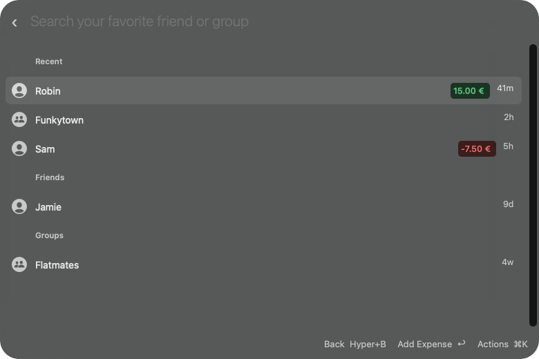
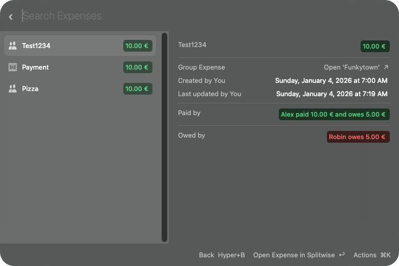
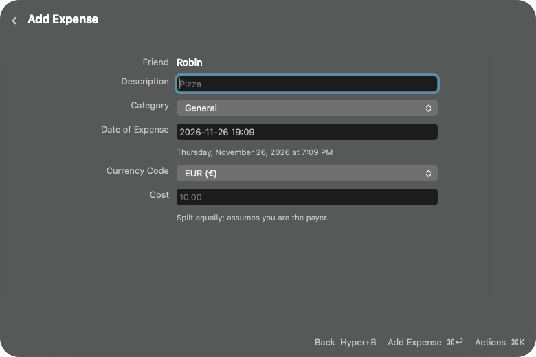
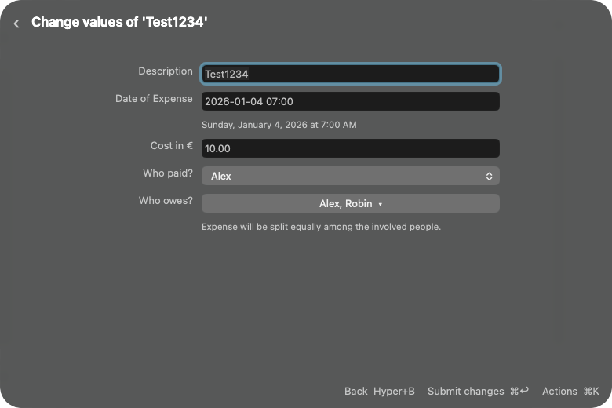

# Splitwise for Alfred

Add expenses with friends and groups, and search, review, change and delete your Splitwise
expenses in a native Alfred 6 window. A port of the
[Raycast Splitwise extension](https://www.raycast.com/ilian/splitwise) by ilian and contributors.





Requires macOS, Alfred 6 with Powerpack, Node.js 22+ or Bun, a Splitwise account and an internet
connection. Screenshots use made-up people.

## Connect

The first time you open it, the window asks for an API key:

1. Register an app at [secure.splitwise.com/apps](https://secure.splitwise.com/apps): any name
   (for example "Alfred"), a short description and any homepage URL.
2. Press **Register and get API key**, copy the **API key** and paste it into the window.

The key is stored in your macOS Keychain (service `com.izsk.splitwise`), not in Alfred's
preferences, and is sent only to Splitwise. **Actions → Disconnect Splitwise** removes it and the
cached data.

## Add Expense (`split`)

**Recent** (your three latest friends or groups), then **Friends** and **Groups**, each with
picture, balance (green: you are owed, red: you owe) and last activity. Type to filter.



↩ opens **Add Expense**: description, category (Splitwise's subcategories), date, currency (your
default first) and cost. With a friend, you pay and the cost is split in half; in a group it is
split equally. ⌘↩ adds it, returns to the list and refreshes balances.

Dates accept `2026-01-04 12:00`, `today`, `yesterday 18:30`, `tomorrow`, `-3d`, `+1w` or `6pm`;
the line under the field shows how it was read.

## List Expenses (`expenses`)

Your latest expenses (250 by default, see Configuration), searchable by description and people.
The right pane shows the amount (green if you're owed overall, red if you owe), the group with a
link, when it was created and last updated, who paid, who owes or received, repeating interval
and receipt.



| Key | Action |
| --- | --- |
| ↩ / ⌘O | Open the expense (or friend, group) in Splitwise |
| ⌘E | Change Values: description, date, cost, who paid, who owes (split equally) |
| ⌘Y | View Receipt |
| ⌘R | Reload |
| ⌃X | Delete Expense (asks first; Splitwise can restore it on its website) |
| ⌘K | Actions menu with all of the above |
| Hyper+B | Back one screen; from the first screen, back to Alfred's search |

As in the Raycast extension, Change Values is offered for expenses with one payer and an equal
split; others open in Splitwise. Shares are computed to the cent so they always add up to the cost.

## Configuration

Keywords (`split`, `expenses`), number of expenses to load, Actions and Back shortcuts, and the
Node.js path. The External Triggers `add` and `list` open the two screens from other workflows.

## Development

```sh
bun install --frozen-lockfile
bun run check
bun run package
bun run link
```

The package is `dist/Splitwise.alfredworkflow`. `ui/window.ts` and `scripts/plist.ts` generate the
window shell and `info.plist`; screens are built at runtime by `src/screens.ts`. Tests use
synthetic data and a mocked network. Releases use `z-splitwise/vX.Y.Z`.

## Credits and AI disclosure

Feature design, behaviour and icon from the
[Raycast Splitwise extension](https://github.com/raycast/extensions/tree/e38232e713cc42a58cac81b8d3af9261fd1624e5/extensions/Splitwise)
by ilian, Diogo Ferrer, djpowers and Damian Duchnowski (MIT). See
[THIRD_PARTY_NOTICES.md](THIRD_PARTY_NOTICES.md) and [LICENSE](LICENSE). Not affiliated with
Splitwise.

This workflow was built with the help of AI tools. Review it before use and report issues on the
[project tracker](https://github.com/sk-izsk/z-alfred-workflow/issues).
