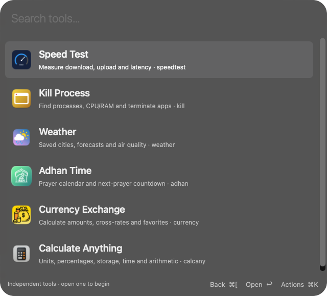

# Swiss for Alfred

One searchable menu for your independent Alfred tools. Each keeps its own keyword, settings, package
and release. Swiss does not load their engines or make network requests until you open a tool.



Requires macOS, Alfred 6 Powerpack and Node.js 22+ or Bun.

| Tool | Default direct keyword | Required workflow |
| --- | --- | --- |
| Workflow Manager | `wfman` | Workflow Manager 0.1.0+ |
| Translate | `translate` | Translate 0.1.0+ |
| Folder Navigator | `folders` | Folder Navigator 0.1.0+ |
| Tag Manager | `tags` | Tag Manager 0.1.0+ |
| System Monitor | `sysmon` | System Monitor 0.1.0+ |
| Mole | `moleui` | Mole 0.1.0+ |
| World Clock | `wclock` | World Clock 0.1.0+ |
| Speed Test | `speedtest` | Speed Test 0.1.3+ |
| Kill Process | `kill` | Kill Process 0.1.0+ |
| Weather | `weather` | Weather 0.1.0+ |
| Adhan Time | `adhan` | Adhan Time 0.1.0+ |
| Currency Exchange | `currency` | Currency Exchange 0.1.0+ |
| Calculate Anything | `calcany` | Calculate Anything bridge 0.1.0+ and its original conversion engine |

Camera is deferred. Last Changed Files was canceled and is not included.

## Use

Type **`swiss`**, search by tool name or keyword, then press Return. Missing or older tools are labeled;
Swiss never downloads anything automatically. Install the matching independent packages first.
Direct keywords remain configurable in each workflow. **Copy Default Shortcut** shows the documented
default, which can differ if you customized that workflow.

↑/↓ select. **⌘K Actions** contains Open Tool, Copy Default Shortcut, Refresh Installed Tools and
Download Workflows. ⌘R refreshes installation status. **Back (⌘[)** is configurable and always visible
in the footer, outside Actions.

A tool opened from Swiss returns to the same launcher search and selected row when its own root
Back is used. Its sheets/child views still return one level first: Swiss → Weather Cities → Report
returns Report → Weather Cities → Swiss. Direct tool launch Back keeps returning to Alfred search.
A launcher session lasts up to 24 hours; type swiss again if an old session expires.

## Extend

Add one entry to `src/tools.ts`: stable ID, title, description, bundle ID, external trigger, minimum
version and default keyword. Add a credited icon under `assets/tools/`. No other tool code belongs in
this launcher. A new independent tool should implement the protocol in [NAVIGATION.md](NAVIGATION.md).

There is no shared runtime dependency between workflows. The small navigation parser is copied into
each independent package; its compatibility tests travel with that workflow.

## Development

```sh
bun install --frozen-lockfile
bun run check
bun run package
bun run link
```

Output: `dist/Swiss.alfredworkflow`. Tag: `z-swiss/vX.Y.Z`.
See [TESTING.md](TESTING.md). No user settings or caches are included in Git/packages.

## Credits and AI disclosure

Swiss icon is original, rendered from Apple SF Symbols. Tool icons retain their MIT credits; see
[THIRD_PARTY_NOTICES.md](THIRD_PARTY_NOTICES.md). Built with help from AI tools.
