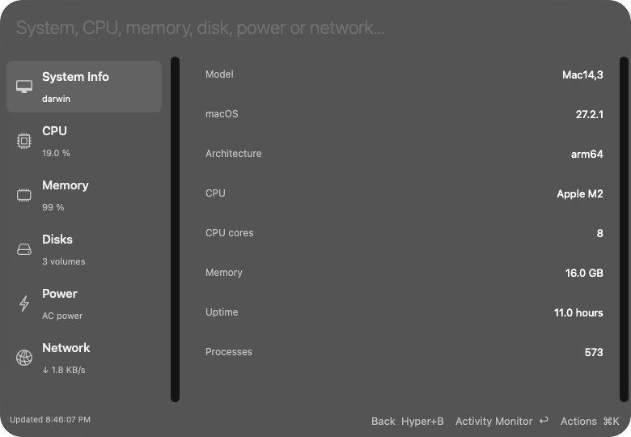

# System Monitor for Alfred 6

A live overview of your Mac: system, CPU, memory, disks, power and network, in a native Alfred window.



Requires macOS, Alfred 6 with Powerpack and Node.js 22+ or Bun.

## Open

Type `sysmon`, or choose System Monitor in Swiss. Sections are listed on the left with usage badges;
the selected section's details are on the right.

- **CPU and network** rates come from successive samples, so the first reading says *Measuring*.
- **Network** shows interface rates and the five busiest processes when macOS allows `nettop`.
- **Memory** shows physical allocation (including caches), VM categories, swap and top processes.
- **Disks** include mounted external drives with filesystem, protocol and SMART details.
- **Power** shows the source, battery status, capacity and cycle count when reported.

## Actions

- **↩** opens Activity Monitor.
- **⌘K**: Pause/Resume, Refresh, Copy Section, Open Activity Monitor and Configuration.
- **Back** (Hyper+B) returns to Swiss with its search and selection, when opened there.

## Notes

- Refreshes every 5 seconds while the window is open (2–60 seconds in Configuration). No background
  daemon.
- Temperature and fan sensors aren't available from the standard tools; the CPU section says so.
  Missing or protected fields show *Unavailable*.
- Process CPU from `ps` and total CPU from counters use different intervals, so numbers won't match
  Activity Monitor at every instant.

## Configuration

<!-- config:start (generated by scripts/readme-config.ts from info.plist; do not edit) -->
Open the workflow in Alfred Preferences → **Configure Workflow**.

| Setting | Default | What it does |
| --- | --- | --- |
| Keyword | `sysmon` | Open System Monitor. |
| Back shortcut | Hyper+B (`⌃⌥⇧⌘B`) | Hyper modifier checkboxes plus a Back key; turn Hyper off to use a custom shortcut instead. |
| Refresh interval (seconds) | `5` | Live refresh while the window is open: 2–60 seconds. |
| Actions shortcut | `⌘K` | Open actions. |
| Node.js executable | — | Optional absolute executable path. |
| Open window | Inside Alfred |  |
<!-- config:end -->

## Development

```sh
bun install --frozen-lockfile
bun run check
bun run package
bun run link
```

Width, Back and footer follow [UI_CONVENTIONS.md](../../UI_CONVENTIONS.md).

## Credits and AI disclosure

References: [Raycast System Monitor](https://github.com/raycast/extensions/tree/86a5e3dc08b9e9c30a9ef9c78228701ef375f3d6/extensions/system-monitor/)
and the atop Alfred workflow. No source or artwork copied. MIT; see
[THIRD_PARTY_NOTICES.md](THIRD_PARTY_NOTICES.md). Built with help from AI tools.
