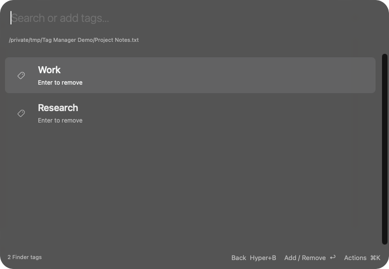
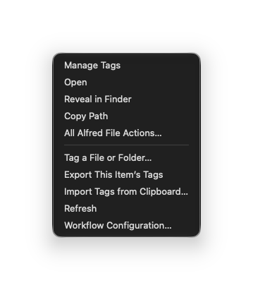

# Tag Manager

An independent Alfred 6 workflow for **Finder tags on files, folders and applications**, across the entire Spotlight-indexed system, including external drives. Open it with `tags` or through Swiss.

Search by name, path or tag. Enter manages the selected item's tags: type a new tag to add it; select an existing tag and press Enter to remove it. The native file icon identifies each item. Open, Reveal in Finder, Copy Path and All Alfred File Actions (including installed integrations) are available in **⌘K**.

**Tag a File or Folder…** accepts an absolute path, including `/Volumes/My SSD/…`. You can also pass a path directly after the keyword. Symbolic links are rejected: select their original file instead. Missing files and read-only volumes show errors rather than pretending tags were saved.

The window uses the shared **780-point width** and screen-aware sizing. **Back Hyper+B** returns to the previous search and selected row; at the first level it returns to Swiss or Alfred. Configuration exposes the Hyper toggle, four modifier checkboxes, Back key and an alternative custom shortcut. Back is visible outside Actions, including every sheet.





## Import and export

Export the current filtered items or the item being edited to the clipboard as Tag Manager v1 JSON. Import from the clipboard shows a scrollable preview of every path and its proposed tags before you apply it. Imports **merge** tags, preserve existing tag colours and other metadata, and never delete existing tags. Paths must already exist on this Mac; exports from another machine may require paths to be adjusted. Raycast's private app-tag database is not this format.

An import accepts up to 500 paths, 100 tags per path and 2 MB of JSON. It reports failures or unprocessed items. Operations have time limits; unavailable volumes may therefore leave a partial import. Reapplying the same import does not duplicate tags.

## Index and configuration

**Search entire system** is enabled by default. The Spotlight query covers all indexed system locations and mounted volumes, including `/Applications` and external SSDs. Disable that checkbox to restrict discovery to the semicolon-separated Search locations field (default `~;/Volumes;/Applications`).

Search text is sent to Spotlight before the first-500-results limit, rather than filtering only an initially loaded subset. Query/scope changes invalidate the cached result automatically. If global discovery returns nothing or fails, a read-only application-folder fallback checks tagged app bundles directly. Finder tag discovery for arbitrary files still depends on Spotlight indexing; a folder excluded from Spotlight can be opened by its full path to manage its tags. Items tagged through this workflow are also remembered locally without waiting for indexing.

The index refresh interval defaults to **5 minutes**, configurable from 1–60. **Refresh** bypasses it. The first 500 paths for the current search are loaded, with a visible limit indicator; narrow the search text or locations for a large collection. Unavailable locations are reported, and a failed scan can retain a visibly stale index. Editing tags updates the cached index immediately.

Tags remain in the files' native metadata. Local cache/data contains file paths and tag names, not file contents. The workflow does not install a tagging CLI or contact a remote API. New tags have no colour; existing colours are preserved.

## Build and verification

```sh
bun install
bun run check
bun run package
bun run link
```

Tests change tags only on disposable temporary files and verify native binary-plist round trips, colour/other-xattr preservation, input validation, symlink rejection, immediate cache updates and Back history. Physical Hyper-key delivery requires an actual keyboard check.

## References and license

Inspired by [Raycast App Tag Manager](https://github.com/raycast/extensions/tree/e38232e713cc42a58cac81b8d3af9261fd1624e5/extensions/app-tag-manager/) and the installed Tag Finder workflow. The former uses custom app tags; this implementation uses macOS Finder metadata to cover all file types. No reference code or artwork was copied. MIT; built with help from AI tools.

Shared UI: windows use the 780-point reference width with active-display clamping. Back defaults to Hyper+B (Control + Option + Shift + Command + B); Configuration includes the Hyper toggle, four modifier checkboxes, Back key and custom shortcut. Footer labels use Hyper+B. Existing explicit custom Back shortcuts remain active until Hyper configuration is explicitly saved.

File rows show native tag pills beside their names, with full paths and overflow-tag tooltips. The tag editor retains explicit Add/Remove actions.

## Configuration

<!-- config:start (generated by scripts/readme-config.ts from info.plist; do not edit) -->
Open the workflow in Alfred Preferences → **Configure Workflow**.

| Setting | Default | What it does |
| --- | --- | --- |
| Keyword | `tags` | Open Tag Manager. |
| Back shortcut | Hyper+B (`⌃⌥⇧⌘B`) | Hyper modifier checkboxes plus a Back key; turn Hyper off to use a custom shortcut instead. |
| Search entire system | On |  |
| Search locations | `~;/Volumes;/Applications` | Used only when Search entire system is disabled. Semicolon-separated locations. |
| Index refresh (minutes) | `5` | Cache the tagged-file index for 1–60 minutes. Refresh bypasses this. |
| Actions shortcut | `⌘K` | Open actions. |
| Node.js executable | — | Optional absolute executable path. |
| Open window | Inside Alfred |  |
<!-- config:end -->
