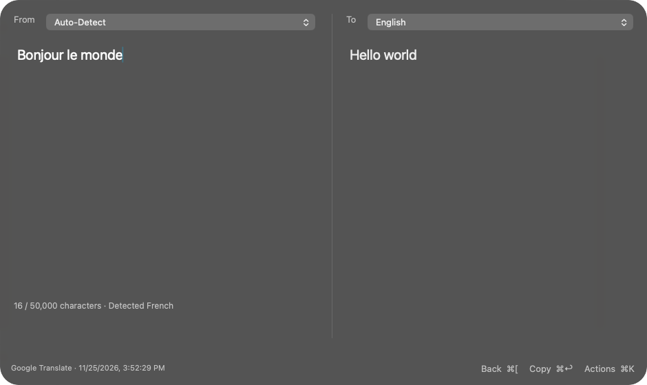
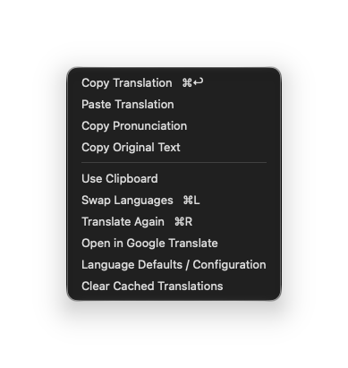

# Translate

A native split Translation window for Alfred 6: original text on the left, translated text on the right, with **From** and **To** language dropdowns at the top. Launch with **`translate`** or choose **Translate** in Swiss.

Requires macOS, Alfred 6 Powerpack and Node.js 22+ or Bun. The provider matches the pinned Raycast Google Translate reference and **does not require an API key**.





## Using Translation

Copy some text, then invoke Translate without an argument: it reads the clipboard once and translates it. A typed argument such as `translate Bonjour le monde` takes precedence. Automatic clipboard input can be disabled in Workflow Configuration. **Use Clipboard** in ⌘K explicitly reloads it later.

Edit the left pane to translate after typing pauses. Inputs support **50,000 Unicode characters**. Long text is split at paragraph/word boundaries into requests of up to 4,500 characters, with parts translated sequentially and progress shown in the footer. Completed parts appear while later parts load; copying is enabled when the full translation finishes. If a request fails, **Continue Translation** appears in Actions and resumes the remaining parts without repeating completed work. From supports **Auto-Detect**; To selects one of 249 languages, including Bengali. The detected language appears under the original text. Pronunciation appears under the translation when Google provides it. Language choices persist between launches; Workflow Configuration provides initial defaults.

The split window keeps a large editing area with compact metadata and footer spacing. Both panes scroll for longer text, and translated text can be selected directly. **⌘↩** copies the completed translation. Copy is disabled during typing, and request tickets prevent earlier results from replacing newer text. **⌘L** swaps languages and moves the translation into the original pane.

**⌘K** includes Copy Translation, Paste Translation, Copy Pronunciation, Copy Original Text, Use Clipboard, Swap Languages, Continue Translation, Translate Again (⌘R), Open in Google Translate, language defaults/configuration, and Clear Cached Translations. Paste closes the UI, copies the result and uses macOS Accessibility to paste into the previously focused app; the OS may request permission when first used.

Back is visible outside Actions, with a configurable default of **Hyper+B**. A Swiss launch returns to its saved query/selection. Direct launches return to Alfred search.

## Provider, refresh and local data

Text is sent to Google only for the translation being requested. The implementation uses the same public web endpoint as the Raycast reference, with POST bodies for the text. This endpoint can change or rate limit requests; failures remain explicit, and Open in Google Translate offers the provider’s website.

Response caching is **off by default**. `cache_minutes` accepts 0 to disable or 1–10080 minutes to cache locally. Translate Again bypasses the cache. The footer shows the response’s original fetch date/time. Failed requests clear the result rather than leaving a previous translation available to copy.

UI sessions and optional response caches are private files in Alfred’s workflow cache. Old UI sessions are cleaned up after 24 hours; optional response files are removed after the configured cache lifetime when opening the tool. Disabling response caching clears those files on the next launch; Clear Cached Translations removes stored responses immediately. Language choices live in Workflow Data. Clipboard monitoring and a translation history database are not used.

## Build

```sh
bun install --frozen-lockfile
bun run check
bun run package
bun run link
```

The build generates the UI and `info.plist` from TypeScript. Tests use fake clipboard readers, synthetic provider responses and temporary directories. See [TESTING.md](TESTING.md).

## Configuration

<!-- config:start (generated by scripts/readme-config.ts from info.plist; do not edit) -->
Open the workflow in Alfred Preferences → **Configure Workflow**.

| Setting | Default | What it does |
| --- | --- | --- |
| Keyword | `translate` | Translate typed text or the clipboard. |
| Initial source language | Auto-Detect |  |
| Initial target language | English |  |
| Clipboard | On |  |
| Translation cache (minutes) | `0` | 0 disables response caching; 1–10080 caches translations locally. Language choices persist separately. |
| Back shortcut | Hyper+B (`⌃⌥⇧⌘B`) | Hyper modifier checkboxes plus a Back key; turn Hyper off to use a custom shortcut instead. |
| Actions shortcut | `⌘K` | Open actions. |
| Node.js executable | — | Optional absolute executable path. |
| Open window | Inside Alfred |  |
<!-- config:end -->

## Credits

[Raycast Google Translate](https://github.com/raycast/extensions/tree/e38232e713cc42a58cac81b8d3af9261fd1624e5/extensions/google-translate/) supplies the pinned icon/language catalog and reference behavior. Request/response handling adapts the vendored [TRACTION google-translate](https://github.com/iamtraction/google-translate) transport using standard fetch. MIT notices are bundled in [THIRD_PARTY_NOTICES.md](THIRD_PARTY_NOTICES.md). Google Translate is a Google trademark. Built with help from AI tools.

Shared UI: windows use the 780-point reference width with active-display clamping. Back defaults to Hyper+B (Control + Option + Shift + Command + B); Configuration includes the Hyper toggle, four modifier checkboxes, Back key and custom shortcut. Footer labels use Hyper+B. Existing explicit custom Back shortcuts remain active until Hyper configuration is explicitly saved.
