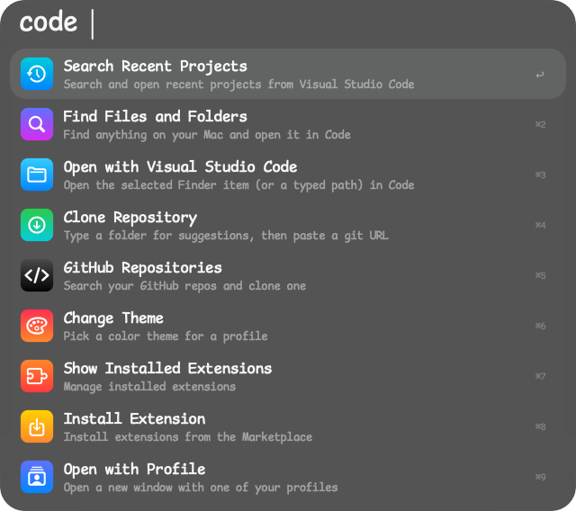
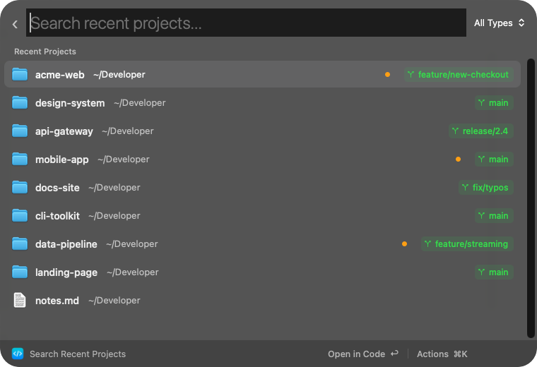
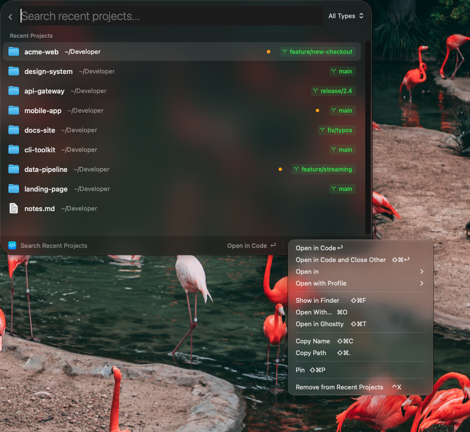
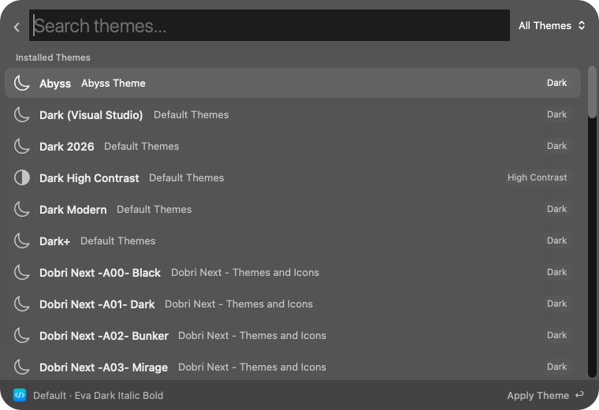
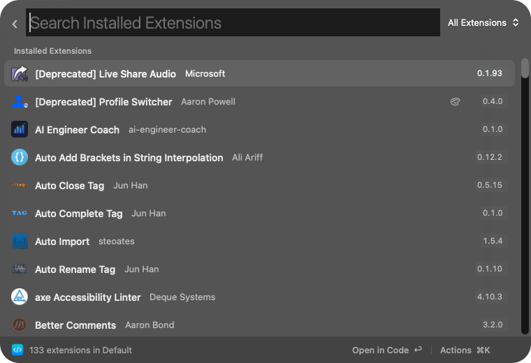
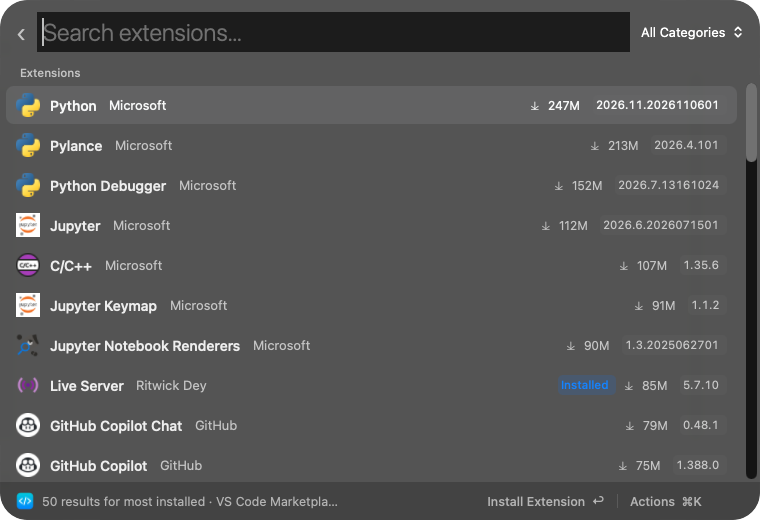
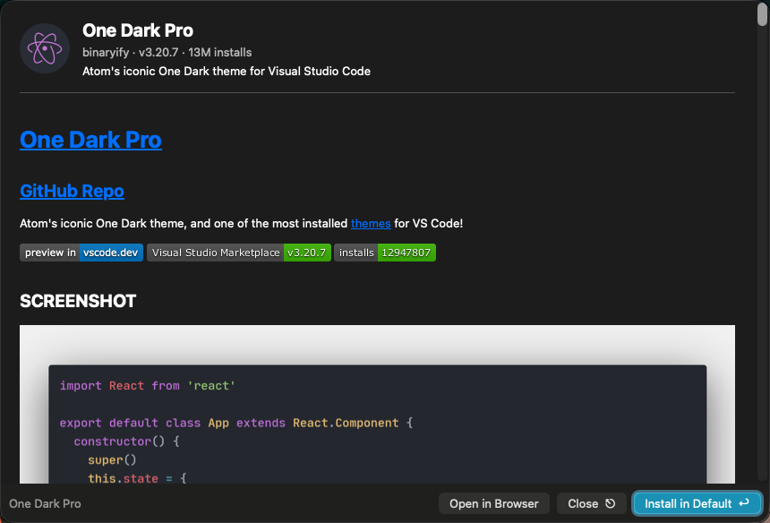
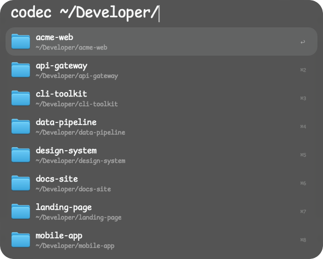

# VS Code for Alfred

Open recent projects, manage extensions and clone repositories in **VS Code, Cursor, Windsurf,
Zed, VSCodium** and other VS Code forks, from [Alfred 6](https://www.alfredapp.com).
Built on Alfred UI, Alfred 6's native window toolkit.

| | |
| --- | --- |
|  |  |
| **`code`**: every command in one menu | **Recent Projects**: Finder icons, git branch, ● uncommitted changes |
|  |  |
| **⌘K**: every action for a project | **Change Theme**: live preview in VS Code |
|  |  |
| **Installed Extensions**: per profile, filter themes | **Install Extension**: most installed first, categories |
|  |  |
| **⌘Y**: README and screenshots, ↩ installs | **`codec`**: pick a folder, paste a git URL |

## Features

| Type | What happens |
| --- | --- |
| `code` | The menu: every command below. Keep typing to filter it. |
| `code <name>` | Search Recent Projects, already filtered. |
| `code install prettier` | Search the Marketplace (or Open VSX for forks). |
| `code https://github.com/owner/repo` | Clone: pick a folder (default from settings), ↩ clones and opens it. |
| `code ~/path/to/folder` | Open that path. |
| `code gh <name>` | Your GitHub repos (plus a public search): ↩ clone window, ⌘↩ clone now. Needs `gh`. |
| `code profile` | Open a new window with one of your VS Code profiles. |
| `code sync` | Settings Sync: sync now, turn on/off (runs the Command Palette command). |
| `code > command` | Run any Command Palette command in your editor. |

With a git URL on the clipboard, `code` shows **Clone owner/repo** first (turn off in the configuration).

**Search Recent Projects**: folders, files, workspaces and remotes, with Finder icons, the git branch,
uncommitted changes (●), ahead/behind (↑↓) and pins. Set **Project Folders** to also list git repos you
haven't opened yet. Filter by type (⌘P), including Git Repos. ↩ opens; ⌘K shows every action:
open and close other windows ⇧⌘↩ · Open in ▸ another editor · Open with Profile ▸ · Show in Finder ⇧⌘F ·
Open With… ⌘O (Alfred's File Actions) · Open in Terminal ⇧⌘T (Ghostty, iTerm…: set Terminal App) ·
Open on GitHub ⇧⌘G · Copy Remote URL · Copy Name ⇧⌘C · Copy Path ⇧⌘. · Pin ⇧⌘P · Remove from Recent Projects ⌃X.

**Change Theme** (`codet`): every color theme available in your profile (packs with several themes show one
row each), filtered by Light/Dark/High Contrast. Moving through the list previews each theme live in VS Code,
like its own theme picker; ↩ keeps it, ⎋ puts the old one back.

**Profiles**: Change Theme and the extension windows work on one VS Code profile: set **VS Code Profile** in
the Workflow Configuration, or leave it blank to follow the profile of your most recently opened project.

**Clone** (`codec [folder] [url]`): type a folder name for suggestions (Spotlight, or a path with Tab to
drill down), then paste a URL, or have one on the clipboard. ↩ opens the clone window with that folder,
⌘↩ clones and opens right away.

**Show Installed Extensions**: for your profile, filter All / Themes / Other. Preview the Marketplace page
(⌘Y), open in the editor or browser (⇧⌘O), Show in Finder (⇧⌘F), Copy ID (⇧⌘C), Uninstall from the profile.

**Install Extension**: search as you type, or pick a category (Themes, Languages, Formatters…) to see the
most installed. Install counts, version, an "Installed" tag, Install in Another Profile ▸.
**⌘Y** previews the README with screenshots (↩ installs, ⎋ closes). **⌘T tries a theme** you don't have:
it's installed for a moment and applied in VS Code; ⌘T again cycles through the pack, ↩ keeps it, closing the
window uninstalls it and restores your theme. Optional: try themes automatically while browsing.

**Find Files and Folders** (`codef`): Spotlight search, opened in your editor (↩). ⌘↩ opens it in your
terminal, ⌥↩ reveals it in Finder, and → shows Alfred's actions, including this workflow's Universal Actions
for any file or folder: Open and Close Other Windows, Open in Another Editor…, Open with Profile…,
Open in Terminal, Open on GitHub. There's also an
**Open in Code Editor** File Action, and **Open with …** for the Finder selection.

⌘[ goes back to the menu from any window. Shortcut keywords: `codep`, `codee`, `codei`, `codec`,
`codef`, `codet`, `coden`; all of them can be changed in the Workflow's Configuration, where you also pick the
editor, the clone folder, the terminal app and a hotkey.

## Editors

Tested with **Visual Studio Code**. The other editors in the picker (Insiders, Cursor, Windsurf, VSCodium,
Kiro, Positron, Trae…) are VS Code forks that store recent projects, settings, profiles and extensions the
same way, so they should work, but they're untested; reports and fixes welcome. Zed support is limited to
recent projects, opening, cloning and finding (no extensions, themes or profiles).

## Install

1. Download the latest `.alfredworkflow` from [Releases](https://github.com/sk-izsk/z-vscode-workflow/releases).
2. Double-click it and Alfred imports it.
3. Type `code` in Alfred.

### First-time setup

Open Alfred Preferences → Workflows → **VS Code** → **Configure Workflow**:

- **Editor**: the editor to open projects in (Visual Studio Code by default).
- **VS Code Profile**: the profile Change Theme and the extension windows use. Leave it blank to follow the
  profile of your most recently opened project.
- **Clone Into**: the default folder for `codec`.
- **Project Folders**: folders to scan for git repos you haven't opened yet (optional).
- **Terminal App**: e.g. `Ghostty`, `iTerm`, `Warp` (default: Terminal).
- **Keywords**: change any of the `code…` keywords, and set a Hotkey for Recent Projects if you like.

Also:

- **Accessibility**: `code sync` and `code > command` type into VS Code's Command Palette, so Alfred needs
  Accessibility permission (System Settings → Privacy & Security → Accessibility → Alfred).
- **GitHub search** (`code gh`): install and sign in to the [GitHub CLI](https://cli.github.com):
  `brew install gh && gh auth login`.
- **Other VS Code workflows**: disable them if they also use the `code` / `codef` keywords.

## Updating

Download the newer `.alfredworkflow` from Releases and double-click it. Alfred keeps your configuration.

## Requirements

- Alfred 6 with the Powerpack
- Node.js (Homebrew, nvm, Volta, fnm… are found automatically)
- Your editor's app in `/Applications` or `~/Applications`

No API keys. The Marketplace search is public, and cloning uses your own git credentials (SSH keys
or the macOS Keychain).

## Development

This workflow is maintained in the [central repository](../../README.md). Existing downloads
above remain available; future releases use workflow-specific tags in the central repository.

```bash
git clone https://github.com/sk-izsk/z-alfred-workflow.git
cd z-alfred-workflow/workflows/z-vscode
bun install --frozen-lockfile
bun run build     # bundle src/ → workflow/bin/vsc.mjs, write ui.json + info.plist
bun run link      # symlink workflow/ into Alfred (then edit, rebuild, reopen)
bun run check     # typecheck, oxlint, oxfmt, tests
bun run package   # dist/VS Code.alfredworkflow
```

```
src/            runtime (Node), small modules: editors, projects, git, extensions, marketplace, clone…
src/commands/   one file per window/menu; each returns Alfred UI JSON actions
ui/             window definitions in TypeScript → workflow/<name>.alfredui/ui.json
scripts/        build, info.plist (plist.ts), icons, link, package
workflow/       what Alfred loads (UI JSON and info.plist are generated; runtime bundle is git-ignored)
```

### Releasing

Follow the central [release guide](../../RELEASING.md). Tags use `z-vscode/vX.Y.Z`;
the release action builds and attaches `VS Code.alfredworkflow`.

See [AGENTS.md](AGENTS.md) for conventions.

## Credits

- [Visual Studio Code for Raycast](https://github.com/raycast/extensions/tree/main/extensions/visual-studio-code-recent-projects)
  by thomas and its many contributors (MIT): the commands, their wording, the list of
  supported editors and the Marketplace query this workflow is modelled on.
- [Visual Studio Code workflow for Alfred](https://github.com/alexchantastic/alfred-open-with-vscode-workflow)
  by Alex Chan: the `code` keyword and the `codef` file search this one grew out of.
- [Alfred](https://www.alfredapp.com) and Alfred UI by Running with Crayons.

## AI disclosure

This workflow was built with the help of AI tools, directed and tested by a human. Review the code
before use, as you would any workflow; please report anything that doesn't work.

## License

MIT. Parts are adapted from the MIT-licensed Raycast extension; see [THIRD_PARTY_NOTICES.md](THIRD_PARTY_NOTICES.md).
