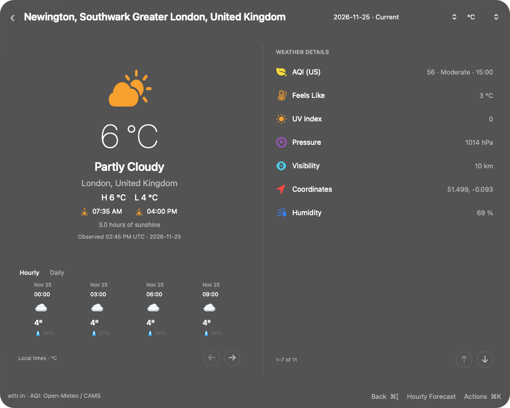

# Weather for Alfred

Saved cities, colorful current conditions, and detailed forecasts in a native Alfred 6 window.
Inspired by [Raycast Weather](https://www.raycast.com/tonka3000/weather), using the same wttr.in provider.



Requires macOS, Alfred 6 with Powerpack, Node.js 22+ or Bun, and internet access for new reports.
No API key, device location permission or runtime software installation is required.

## Open and save locations

- Type **`weather`** to browse saved cities.
- Type **`weather London, United Kingdom`** to open a report directly.
- Set multiple predefined cities in Workflow Configuration, separated by semicolons:
  `Toronto, Canada; London, United Kingdom; Dhaka, Bangladesh`.
- Use **Actions → Add City** or **Save This City** for additional saved locations. Remove Saved City
  also hides a location defined in configuration; adding the same location restores it.

Use country names for ambiguous cities. wttr.in resolves each query to a nearby reporting area;
the header displays the actual area, region and country returned by the provider. For example,
a London query can resolve to a district inside Greater London.

## Report and forecast

The left half shows a large weather icon, temperature, conditions, high/low, sunrise/sunset and the
provider’s observation time (UTC). Its bottom forecast has Hourly/Daily tabs and left/right buttons
for browsing four time slots at a time. All controls use native Alfred views and theme colors.

The right half shows seven measurement rows at a time, including AQI, feels-like temperature, UV
index, pressure, visibility, coordinates, humidity, cloud cover, wind, precipitation and moon
information. Use the bottom up/down buttons or keyboard arrows for the remaining rows. There are
no scrollbars and the forecast stays entirely inside the left half.

AQI uses the **US scale**, with a colored category and model timestamp. **Actions → Air Quality
Details** includes the full category, timezone and available current PM₂.₅/PM₁₀ measurements. Data
comes from [Open-Meteo / CAMS](https://open-meteo.com/en/docs/air-quality-api), represents a regional
model rather than a local sensor, and is cached for fifteen minutes. Future dates use that day’s
noon AQI forecast when available; missing or failed data is explicitly marked unavailable.

Use the date picker for the available forecast days. The first date shows current conditions;
other dates show the provider’s noon forecast slot. **Hourly Forecast** displays the day’s local
forecast time slots, temperatures, conditions and rain probabilities. The service generally supplies
three days in three-hour slots. Missing measurements display a dash rather than a made-up value.

The unit picker switches between °C/km/h/km/mm/hPa and °F/mph/mi/in/inHg. Set the default in Workflow
Configuration. Changing units in a report applies to that window without changing your configured default.

## Navigation and Actions

| Shortcut | Behavior |
| --- | --- |
| ↑ / ↓ | Navigate cities or scroll through measurements |
| ← / → | Browse forecast cards in the left half |
| Return | Open the selected city from the list |
| ⌘K | Open the current screen’s Actions menu |
| ⌘R | Refresh the current report; reload saved cities when on the list |
| ⌘[ | Back one level, configurable and visible in every footer |

**Actions** offers Hourly Forecast, Air Quality Details, Copy Weather Summary, Show Location in Maps, Open wttr.in,
Saved Cities, Save/Remove City, Add City and Refresh as appropriate to the screen. Back stays outside
the Actions menu. A report opened from the city list returns to that same query and selected city;
a direct city launch returns to Alfred search. Sheets return to their parent report/list.

## Caching and privacy

Reports are cached for ten minutes. Refresh bypasses the cache. If a refresh fails and a previous
report is available, the footer explicitly marks it as cached; its original observation and forecast
dates remain visible. First-time failures show an error instead of fabricated data. Forecasts are
estimates, and the provider can be unavailable.

City queries and your public IP are visible to wttr.in. Resolved city coordinates and your public IP
are sent to Open-Meteo for air quality. This workflow does not request your Mac’s location or track
you. Saved locations and report cache remain
in Alfred’s local workflow data/cache directories. No background weather service runs while closed.

## Development

```sh
bun install --frozen-lockfile
bun run check
bun run package
bun run link
```

The package is `dist/Weather.alfredworkflow`. `ui/window.ts` and `scripts/plist.ts` generate the UI and
metadata. See [TESTING.md](TESTING.md). Releases use `z-weather/vX.Y.Z`. The `open` external trigger
accepts a city query; Swiss launcher integration will be handled separately.

## Credits and AI disclosure

The Weather icon and feature reference are from [Raycast Weather by tonka3000 and contributors](https://github.com/raycast/extensions/tree/886cbd73fe377ad1d8f0c17083e6cd4c96748a33/extensions/weather), MIT.
Weather data is provided by [wttr.in](https://github.com/chubin/wttr.in); air quality by
[Open-Meteo and the Copernicus Atmosphere Monitoring Service (CAMS)](https://open-meteo.com/en/docs/air-quality-api). No Raycast runtime or wttr.in
server code is bundled. See [THIRD_PARTY_NOTICES.md](THIRD_PARTY_NOTICES.md) and [LICENSE](LICENSE).

This workflow was built with the help of AI tools. Review it before use and report issues on the
[project tracker](https://github.com/sk-izsk/z-alfred-workflow/issues).
