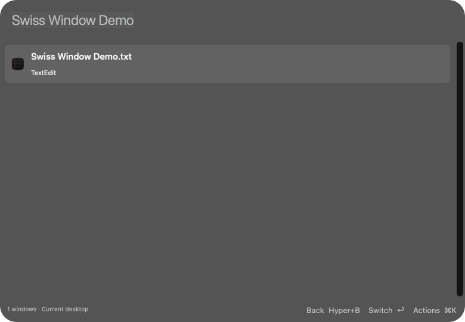

# Window Switcher

Search window titles and application names in **the current desktop only**. Open `wins` or choose Window Switcher in Swiss. Return or a row's primary action brings the selected window forward. Actions offers Close Window, Quit Owning App, Copy Window Title, Refresh, Accessibility Settings and Configuration.



Window Navigator has a scope picker; Window Switcher is intentionally restricted to the current desktop. Navigator includes minimized windows and can restore them. Current-desktop matching uses the window owner's process and geometry from CoreGraphics, excluding minimized windows. All lists refresh on opening or manual Refresh; they are not continually rebuilt while you type.

Requires Alfred Accessibility permission and permission to automate System Events. Grant additional Screen Recording access only if macOS restricts current-desktop window information. Windows not exposed by an app's Accessibility interface cannot be listed. Cross-desktop navigation uses the app's Window menu where available, then falls back to AXRaise; app-specific behavior and desktop-switching preferences can affect it.

Before an action, the workflow revalidates process, application bundle, window index and title. Closing additionally checks geometry. If a window changed or disappeared, it reopens the same search/selection with an error rather than acting on a different window. Quit is a normal app quit request; the app may still show its own unsaved-document prompt. No force-kill, private macOS APIs or bundled helper binaries are used.

The shared width is 780 points with active-display clamping. Back defaults to Hyper+B, with a toggle, four modifier checkboxes and a custom shortcut. Back is visible outside Actions and restores Swiss when launched there. Local UI cache contains window metadata for the session; no remote API is contacted.

```sh
bun install
bun run check
bun run package
bun run link
```

Tests cover search, selection, stable typing, action handoffs and menus. Read-only enumeration was checked against actual apps; raise and close were verified only on a newly created disposable TextEdit document. Quitting user applications was not tested.

References: installed [Window Navigator](https://github.com/zeitlings/alfred-workflows) and [Window Switcher](https://github.com/alfredapp/window-switcher-workflow/). No reference source, artwork or binaries copied. Original implementation/icon MIT. Built with help from AI tools.
