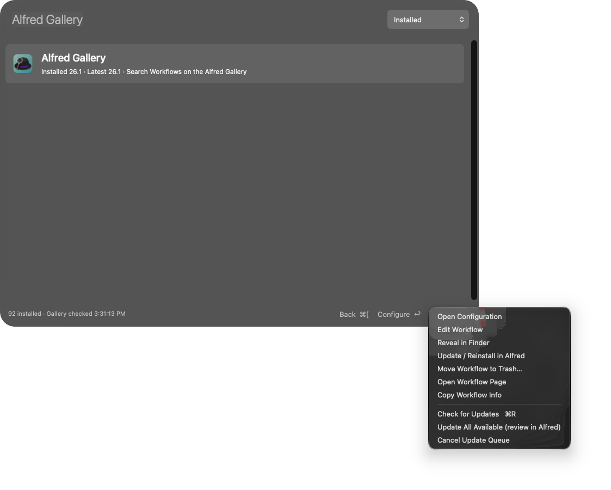

# Workflow Manager

Browse installed Alfred workflows and discover workflows from the official Gallery and this repository’s published releases. Launch with **`wfman`**, or choose **Workflow Manager** in Swiss.

Requires macOS, Alfred 6 Powerpack, and Node.js 22+ or Bun. Each Swiss utility is independently installed; Swiss only opens it when selected.




## Browse and manage

The filter offers **Installed**, **Not installed**, **Updates**, and **All workflows**. Search by name, description or bundle ID. If a Not installed search matches only installed workflows, the empty state explains this and offers Show Installed while keeping the search. Installed workflow icons come from their own folders. Available Gallery icons load on demand and are cached locally; the Swiss family icon is the fallback.

Press Enter to open an installed workflow’s Configuration, or open the selected workflow’s installer. **⌘K** includes:

- Open Configuration, Edit Workflow and Reveal in Finder.
- Install, Update / Reinstall, and open the source page.
- Check for Updates (⌘R), Update All Available and Cancel Update Queue.
- Copy Workflow Info and Move Workflow to Trash with a review sheet.

Update All queues verified Gallery and repository updates, excluding development links and Workflow Manager itself. Each update opens **Alfred’s native installer for review**. After installation is detected, the next installer opens. Cancel from Actions if you decline an installer; closing/reopening Workflow Manager starts a new session. This does not silently overwrite preferences or execute downloaded archives. Native installation retains Alfred’s own dependency and update checks.

Removal moves the installed folder to Trash. Development symlinks are moved as directory entries, without following their targets. Repository files are preserved. Data/cache folders outside the workflow are retained. Remove Workflow Manager itself from Alfred Preferences.

Back is visible outside Actions on every screen and sheet; its configurable default is **Hyper+B**. A Swiss launch returns to the saved Swiss search/selection. Direct launches return to Alfred search.

## Update accuracy and refresh

Gallery entries match by **bundle ID**, including aliases, rather than workflow names. This repository uses its namespaced release tags and matching `.alfredworkflow` assets. Only published stable releases are offered. Workflows without a verified source display **Update source unknown**. Non-numeric version formats display their installed/latest values without guessing that an update exists. Development links are clearly marked.

Metadata defaults to a **60-minute** cache, configurable as `cache_minutes` (1–10080). Check for Updates bypasses it. Failed sources retain cached metadata with a visible warning and original timestamps where available. Installed metadata is read locally on refresh. No scheduled background service runs.

The Gallery catalog is public metadata; this tool does not read installed secrets or preferences. GitHub’s public release API is unauthenticated and can be rate limited. Available third-party workflows are the official Gallery catalog; arbitrary web downloads are not indexed.

## Build and validate

```sh
bun install --frozen-lockfile
bun run check
bun run package
bun run link
```

Tests use temporary metadata/symlink fixtures and mocked network responses; they do not remove or update installed user workflows. UI and `info.plist` are generated from TypeScript. See [TESTING.md](TESTING.md).

## Credits

Inspired by the installed [Alfred Gallery workflow](https://github.com/alfredapp/alfred-gallery-workflow/) and its official catalog. Installation routes remain owned by Alfred. Independent implementation; no upstream workflow code or artwork is bundled. Swiss family icon and scaffold: izsk, MIT. Built with help from AI tools.

Shared UI: windows use the 780-point reference width with active-display clamping. Back defaults to Hyper+B (Control + Option + Shift + Command + B); Configuration includes the Hyper toggle, four modifier checkboxes, Back key and custom shortcut. Footer labels use Hyper+B. Existing explicit custom Back shortcuts remain active until Hyper configuration is explicitly saved.
