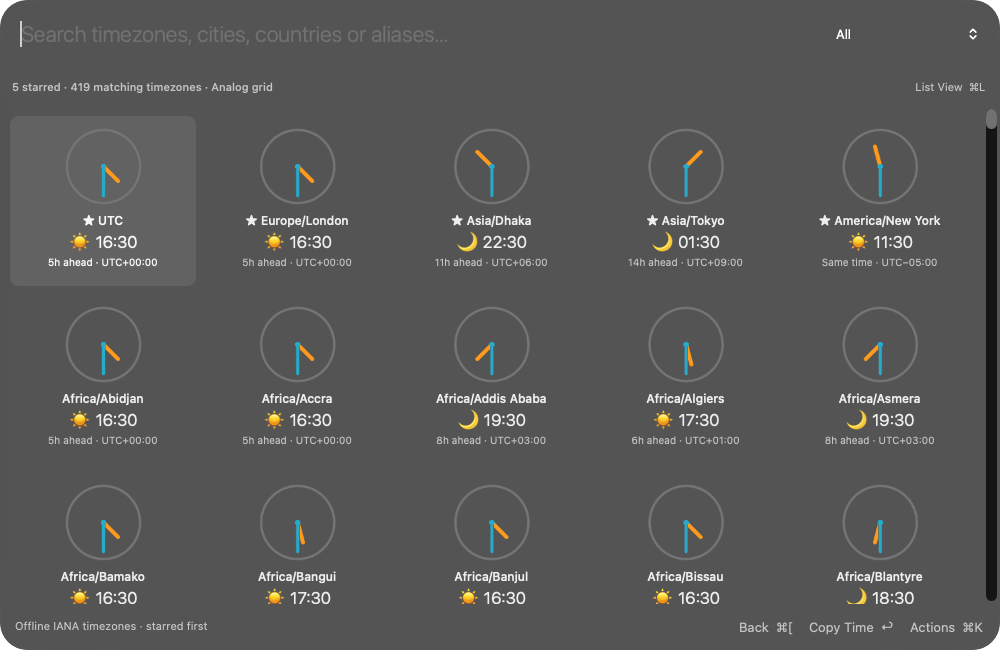
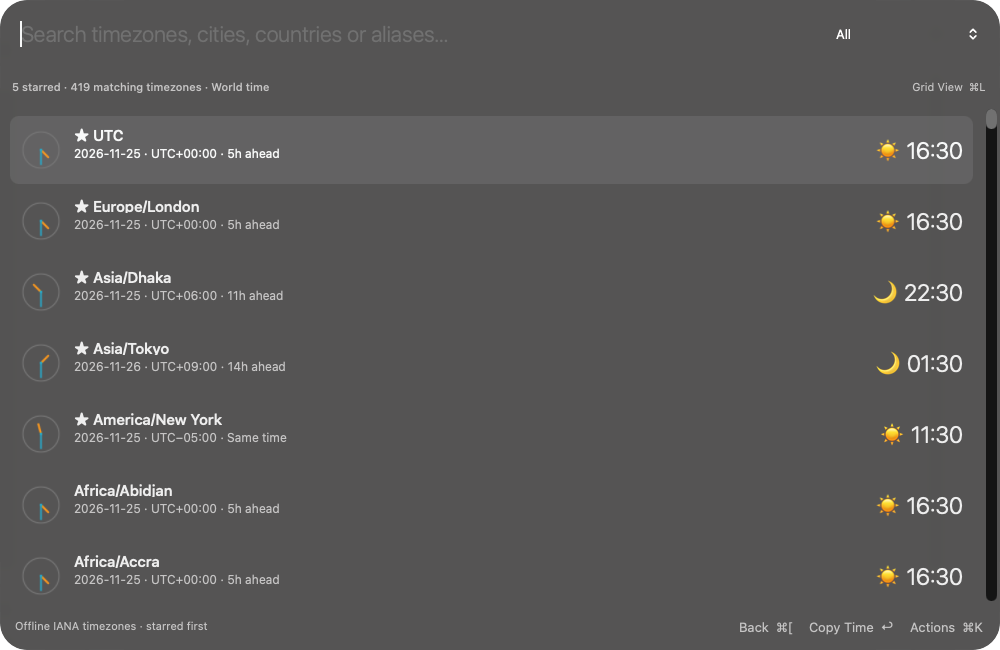

# World Clock for Alfred

Search world timezones and compare starred locations in a native list or analog clock grid.
Inspired by [Raycast World Clock](https://github.com/raycast/extensions/tree/886cbd73fe377ad1d8f0c17083e6cd4c96748a33/extensions/world-clock).





Requires macOS, Alfred 6 Powerpack and Node.js 22+ or Bun. No API key or internet connection is needed.

## Use

Type **`wclock`** to browse timezones, or **`wclock Bangladesh`**, **`wclock Tokyo`** or
**`wclock Europe/London`** to filter immediately. Search matches IANA representative cities, countries,
timezone identifiers, aliases and memos. It is not a geocoder for every city in the world.

Starred zones appear first. Use the dropdown for All, Starred, Other or a region. The list shows the
date, UTC offset, time difference from your Mac and current time. Grid view displays accurate hour and
minute hands with the same digital time and offset underneath. The icon background is transparent and
the window uses native Alfred theme colors.

**⌘L** switches list/grid. Arrow keys navigate the list or both grid axes. Return copies the selected
zone's date/time and UTC offset. Times update when the minute changes while the window is open; no
clock process runs while closed. The sun/moon indicator uses local clock hours (06:00–17:59 versus
night), not astronomical sunrise/sunset.

## Actions and saved locations

**⌘K** includes the relevant reference actions:

- Copy Time and Copy All Info.
- Show Timezone Details, with an enlarged analog clock and metadata.
- Star/Unstar Timezone.
- Edit Timezone: alias, local avatar image path, memo icon/emoji and memo.
- Duplicate Timezone, for different people or notes sharing a timezone.
- Move Up / Move Down, for arranging starred locations.
- Switch List/Grid, World Clock Preferences and Refresh Times.

Preferences choose 12/24-hour time, ISO/US/European dates and 3–6 grid columns. Initial starred zones,
layout and formatting can be set in Workflow Configuration. In-window changes are saved locally and
override those initial defaults. Avatar paths are optional PNG/JPEG/GIF/HEIC/TIFF files; clearing a path
restores the analog icon in the list. Grid cells retain the analog clock. The detail sheet shows a
current snapshot; reopen it for a later snapshot.

**Back (Hyper+B)** is configurable and visible in every footer, outside Actions. Edit, detail and preference
sheets return to the clock list/grid. Launch through **Swiss → World Clock** and root Back restores
the same Swiss search and selection. A direct `wclock` launch returns to Alfred search.

The external `open` trigger accepts a search query, including the Swiss v1 launch envelope. There is
no menubar component.

## Timezone data and privacy

Times and DST rules come from the runtime's IANA timezone database through `Intl`. Half-hour and
quarter-hour offsets are supported. Updating your Node.js/Bun runtime updates its timezone rules.
The available catalog depends on the runtime, typically over 400 zones. Public-domain IANA zone
metadata adds country names and alternate identifiers for searching.

There are no network calls or location permission requests. Your Mac's timezone is used only for the
relative-time comparison. Stars, aliases, memos and avatar paths stay in Alfred's workflow data;
generated transparent clock icons and sessions stay in its cache. No user data or cached time table is
included in the package.

## Configuration

<!-- config:start (generated by scripts/readme-config.ts from info.plist; do not edit) -->
Open the workflow in Alfred Preferences → **Configure Workflow**.

| Setting | Default | What it does |
| --- | --- | --- |
| World Clock keyword | `wclock` | Search cities, countries, timezones and saved aliases. |
| Initial starred timezones | `UTC; Europe/London; Asia/Dhaka; Asia/Tokyo; America/New_York` | Semicolon-separated IANA zones. Used before you customize stars in the UI. |
| Initial layout | List |  |
| Clock format | On |  |
| Date format | YYYY-MM-DD |  |
| Grid columns | 5 |  |
| Actions shortcut | `⌘K` | Open clock actions. |
| Back shortcut | Hyper+B (`⌃⌥⇧⌘B`) | Hyper modifier checkboxes plus a Back key; turn Hyper off to use a custom shortcut instead. |
| Open window | Inside Alfred | Choose Alfred’s window or a separate window. |
| Node.js executable | — | Optional absolute path if automatic discovery fails. |
<!-- config:end -->

## Development

```sh
bun install --frozen-lockfile
bun run check
bun run package
bun run link
```

Output: `dist/World Clock.alfredworkflow`. Tags: `z-world-clock/vX.Y.Z`.
UI and metadata are generated from `ui/window.ts` and `scripts/plist.ts`.
See [TESTING.md](TESTING.md).

## Credits and AI disclosure

Raycast World Clock icon and feature reference: koinzhang, ridemountainpig, litomore and contributors,
MIT. Analog PNG renderer is original. IANA timezone descriptions are public domain.
See [THIRD_PARTY_NOTICES.md](THIRD_PARTY_NOTICES.md) and [LICENSE](LICENSE).

Built with help from AI tools. Review before use and report issues on the project tracker.

Shared UI: windows use the 780-point reference width with active-display clamping. Back defaults to Hyper+B (Control + Option + Shift + Command + B); Configuration includes the Hyper toggle, four modifier checkboxes, Back key and custom shortcut. Footer labels use Hyper+B. Existing explicit custom Back shortcuts remain active until Hyper configuration is explicitly saved.
